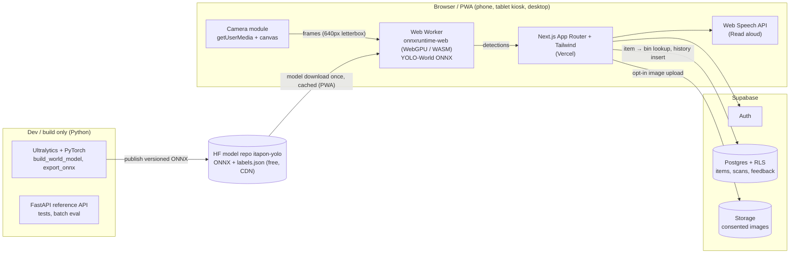

# iTapon: Development Roadmap

**Project:** iTapon, an AI-powered computer vision system for automated waste classification and segregation
**Course:** CS 406 Machine Learning, TIP Quezon City, 1st Sem S.Y. 2026–2027
**Team:** Basilio, Baldovino, Hofilena, Gantang, Gison
**Inputs:** Concept Proposal, Laboratory Activity 5.1 (UI/UX), Figma prototype (mobile, tablet/kiosk, desktop web, "What to do next" recommendation flow)
**Status:** Final, v1.0 (October 17, 2026)
**License:** Open source, AGPL-3.0

---

## Decisions log

These decisions are settled. Reopen one only for a concrete reason, and add a dated row here when you do.

| # | Decision | Choice | Date |
|---|---|---|---|
| D1 | Product name | **iTapon**, used everywhere: repo, domain, PWA manifest, UI copy, manuscript. The "HIWALAY" label in the Figma frames gets replaced with iTapon during Phase 1. | 2026-10-17 |
| D2 | Source code license | **Open source under AGPL-3.0**, matching Ultralytics YOLO's license. Public GitHub repo, `LICENSE` file at the root, license noted in the README and model card. | 2026-10-17 |
| D3 | Loading screen | **Warming-up / loading screen** in the app (Phase 12). *Updated by D12:* it now covers downloading and initializing the in-browser model (first visit) instead of waking a server. Free hosting only. | 2026-10-17 |
| D4 | Frontend stack | Next.js (React, App Router) + Tailwind CSS, hosted on Vercel, mobile-first | 2026-10-17 |
| D5 | ML / API stack | Python, FastAPI, PyTorch, Ultralytics YOLO. *Updated by D12:* Python builds, exports and evaluates the model; production inference runs in the browser. Hugging Face hosts the model files (free model repo), not a Docker Space. | 2026-10-17 |
| D6 | Auth & database | Supabase (Auth, Postgres with RLS, Storage) | 2026-10-17 |
| D7 | ML task type | Object detection with item-level classes; the item → bin mapping lives in the database | 2026-10-17 |
| D8 | v1 class list | **23 classes** (7 recyclable, 4 biodegradable, 8 residual, 4 hazardous), frozen in [`docs/spec.md`](docs/spec.md) §3. Pending sign-off. | 2026-10-17 |
| D9 | Dirty vs. clean items | The model detects the item type only. Contamination is shown as a UI caveat (`contamination_note`), not as separate classes. | 2026-10-17 |
| D10 | Tool versions | Node 20 + pnpm 9, Next.js 16.4 (App Router) + Tailwind v4, Python 3.12 + uv. The repo is under the team member's personal GitHub account (no org). | 2026-10-17 |
| D11 | Model for v0 | **Zero-shot YOLO-World** (Ultralytics), with the 23 spec classes as text prompts baked into custom-vocabulary weights. No training needed to build the app. Phases 3–7 are **deferred, not cancelled**: the course and proposal still expect a trained model for Chapter 4. Confirm the timing with the adviser. | 2026-10-17 |
| D12 | Where inference runs | **In the browser** (ONNX + `onnxruntime-web`, in a Web Worker; WebGPU when available, WASM otherwise). **Why:** since July 2026, free Hugging Face accounts can only create Static Spaces (Docker/Gradio need PRO). Render's free tier (512 MB, 0.1 CPU) is too small for live scanning, and Cloud Run needs a card. **Model files** live in the free HF model repo `itapon-yolo` (CORS-enabled CDN). **FastAPI** stays as the reference/dev API: it's used for testing, batch evaluation and as a fallback if a paid host is ever added. The parity check passed: ONNX gives the same top detections as PyTorch. | 2026-10-17 |

---

## 0. How to read this roadmap

Every phase has the same parts:

- **Goal**: the one thing the phase exists to achieve.
- **Why now**: why it comes at this point in the order.
- **Tasks**: concrete work items.
- **Deliverables**: what exists when the phase is done.
- **Exit criteria**: checks that must pass before you move on.
- **Risks / notes**: what is likely to go wrong.

Phases run in order, but some can overlap. The **ML track** (Phases 3–7) and the **Web track** (Phases 10–13) can run in parallel once Phase 2 is done. Section 3 shows the parallel plan.

---

## 1. Product summary (what we are building)

A **mobile-first web app**, also usable on tablets and desktop and installable as a PWA. It:

1. Opens the camera and **detects one or more waste items** in real time (YOLO object detection).
2. Maps each detected item to one of **four bins**, following RA 9003 (Ecological Solid Waste Management Act) as reflected in the Figma guide:

   | Category       | Bin colour | Examples (from Bin Guide)                                   |
   |----------------|-----------|-------------------------------------------------------------|
   | Biodegradable  | Green     | Food scraps, fruit peels, leaves, used tissue paper          |
   | Recyclable     | Blue      | Plastic bottles, glass, metal, clean paper                   |
   | Residual       | Black     | Mixed garbage, soiled packaging, sanitary waste              |
   | Hazardous      | Red       | Chemicals, batteries, busted light bulbs, expired medicines  |

3. Shows a **large, colour-coded instruction** ("Blue Bin" with an arrow) plus a confidence score and a **Read aloud** button for PWD users.
4. Gives **"What to do next" recommendations** for multi-item scans: reuse first, preparation steps, and the reason for each.
5. Has a searchable **Bin Guide**, a per-user **Scan History**, and a **Kiosk mode** for tablets or monitors mounted above bins.
6. **Logs scans** so institutions can see waste analytics (proposal Expected Output #3).

### Screen inventory (from Figma)

| # | Screen                              | Form factors                  |
|---|-------------------------------------|-------------------------------|
| S1 | Scanning (live camera + bottom sheet) | Mobile, tablet split, desktop split |
| S2 | Result (big bin colour + arrow)     | Mobile                        |
| S3 | Bin Guide (search + 4 categories)   | Mobile, desktop               |
| S4 | History (recent scans)              | Mobile, desktop               |
| S5 | What to do next (multi-item plan)   | Mobile (3 screens), iPad (master/detail) |
| S6 | Before you sort (prep steps + why)  | Mobile, iPad detail pane      |
| S7 | Other scanned items list            | Mobile, iPad left list        |
| S8 | Kiosk scan (split, bin row, Next Scan) | Tablet / monitor            |

> **Branding (D1):** the product is **iTapon**. The Figma frames still say "HIWALAY". Update the Figma header/logo text to iTapon so designs and code match.

---

## 2. Target architecture



### Key architectural decisions (set these early, revisit only with a reason)

| Decision | Choice | Rationale |
|---|---|---|
| ML task type | **Object detection** (not plain classification) | Figma shows "4 items detected" and multi-item plans. Detection gives a label and box per item. |
| Label granularity | **Item-level classes** (e.g. `paper_bag`, `banana_peel`), mapped to a bin through a DB lookup | The UI shows the item name ("Paper Bag") *and* its bin. Bin rules can change per LGU without retraining. |
| Where the bin mapping lives | Supabase `waste_items` table, cached on the client | Rules are content, not model weights. Admins can edit them. |
| Where inference runs (D12) | **On the user's device**: ONNX model in a Web Worker | Free (no inference server), no cold starts, works offline once cached, and camera frames never leave the device (privacy bonus). |
| Who writes scan logs | Frontend, via the Supabase client under RLS | The user's JWT scopes the insert. No server code handles user identity. |
| Real-time strategy | Run the model on frames back-to-back (one at a time, ~1–3 fps depending on the device) with a stability gate | Matches "hold steady" in Figma. Slower phones simply scan at a lower frame rate. |
| Image retention | **Off by default**. Images are uploaded only with explicit opt-in, for retraining. | Data Privacy Act of 2012 (RA 10173). |
| Recommendations | Rule/content-based, from DB fields (`reuse_tip`, `prep_steps`, `why`) | Deterministic and explainable. No hallucination risk. |

### Proposed repository layout (monorepo)

```
itapon/
├─ apps/
│  └─ web/                 # Next.js + Tailwind (Vercel)
├─ services/
│  └─ ml-api/              # FastAPI reference API + model build/export scripts (Python)
├─ ml/
│  ├─ data/                # dataset manifests (NOT raw images; those go to Roboflow/HF Datasets)
│  ├─ configs/             # data.yaml, training hyperparams
│  ├─ notebooks/           # EDA, training, evaluation
│  └─ scripts/             # split, convert, export, evaluate
├─ supabase/
│  ├─ migrations/          # SQL schema + RLS
│  └─ seed.sql             # categories, items, guide content
├─ docs/                   # architecture, API contract, test reports, manuscript assets
└─ .github/workflows/      # CI
```

---

## 3. Phase overview

| Phase | Name | Track | Depends on |
|---|---|---|---|
| 1 | Scope lock, taxonomy & success metrics | Shared | none |
| 2 | Project foundations & tooling | Shared | 1 |
| 3 | Dataset design & collection (**deferred, D11**) | ML | 1 |
| 4 | Annotation, QA & dataset versioning (**deferred, D11**) | ML | 3 |
| 5 | Baseline model training (**deferred, D11**) | ML | 4 |
| 6 | Model improvement & robustness (**deferred, D11**) | ML | 5 |
| 7 | Model evaluation, thresholds & export (**deferred, D11**) | ML | 6 |
| 8 | Inference API (FastAPI), local, on zero-shot YOLO-World | Backend | 1 (class list) |
| 9 | Model export & hosting for in-browser inference (D12) | ML + Web | 8 |
| 10 | Supabase schema, auth & content seed | Backend | 1, 2 |
| 11 | Frontend foundation & design system | Web | 2 |
| 12 | Camera & live scanning | Web | 11, 9 |
| 13 | Result screen & bin guidance | Web | 12, 10 |
| 14 | Multi-item "What to do next" flow | Web | 13 |
| 15 | Bin Guide | Web | 10, 11 |
| 16 | Authentication & Scan History | Web | 10, 13 |
| 17 | Accessibility & PWD features | Web | 13–16 |
| 18 | Kiosk mode (tablet / monitor) | Web | 13, 17 |
| 19 | Institutional analytics dashboard | Web + Backend | 16 |
| 20 | Feedback loop & retraining pipeline | ML + Web | 13, 7 |
| 21 | PWA, performance & offline | Web | 12–18 |
| 22 | Security, privacy & compliance hardening | Shared | 16, 19, 20 |
| 23 | Testing & QA | Shared | all features |
| 24 | CI/CD, production release & monitoring | Shared | 23 |
| 25 | Pilot deployment & user acceptance testing | Shared | 24 |
| 26 | Documentation, manuscript & defense | Shared | 25 |

**Current order (D11):** 1 → 2 → **8 → 9 → 10 → 11 → 12 …**, building the app on zero-shot YOLO-World. Phases 3–7 (dataset + training, using a mix of public Kaggle/TACO/Roboflow data and a small set of local photos) run later or in parallel. Their trained weights replace YOLO-World with no frontend change, because the API contract only returns `class_key`.

**Parallel plan for 5 people (suggested):**
- **ML lead + 1:** Phases 3 → 7 (when resumed), then 20.
- **Backend lead:** Phases 8 → 9 and 10, then 19 and 22.
- **Frontend lead + 1:** Phases 11 → 18, then 21.
- **Everyone:** Phases 1, 2, 23–26.

---

## Phase 1: Scope lock, taxonomy & success metrics

> **Status (2026-10-17): In progress.** [`docs/spec.md`](docs/spec.md) is drafted with the frozen 23-class list, bin mapping with instructions, dirty/clean policy, metrics, personas, user stories and MoSCoW. **Still open:** verify rules R2–R5 against QC/TIP guidelines, update Figma to iTapon, reserve the platform names, and get team and adviser sign-off (spec Section 9).

**Goal:** Turn the proposal and Figma into a frozen, testable specification: which items we detect, which bin each goes to, and what "good enough" means.

**Why now:** Every later phase depends on the class list. Changing classes after annotation is expensive, so this decision comes first.

**Tasks**
1. **Apply the name iTapon (D1):** reserve the GitHub org/repo, Vercel project (`itapon`), HF model repo (`itapon-yolo`), and an optional domain. Update the Figma header text from HIWALAY to iTapon.
2. **Define the item class list** (v1 target: 15–25 classes; fewer, well-represented classes beat many weak ones). Start from items visible in the docs and Figma, then add common campus waste:
   - Recyclable: `plastic_bottle`, `plastic_cup`, `aluminum_can`, `glass_bottle`, `paper_bag`, `cardboard`, `paper_sheet`, `tetra_pack`*
   - Biodegradable: `banana_peel`, `fruit_peel_other`, `food_scraps`, `leaves`, `used_tissue`
   - Residual: `snack_wrapper` (multi-layer), `styrofoam`, `plastic_utensil`, `sanitary_napkin`, `soiled_food_container`, `straw`, `candy_wrapper`
   - Hazardous: `battery`, `light_bulb`, `medicine_blister`/`expired_medicine`, `spray_can`
   - (*) Ambiguous items such as Tetra Pak and plastic cups vary by LGU. Write each one down as a **rule decision** with a source citation.
3. **Write the class → bin mapping table** with a source for each rule (RA 9003, QC LGU guidelines, TIP campus policy).
4. **Define "dirty vs clean" policy.** Example: a greasy paper bag is Residual, a clean one is Recyclable. Decide whether v1 models this as separate classes or as a UI caveat. The Figma "Why this recommendation" copy already handles it as a caveat. **Recommended: caveat in v1.**
5. **Set success metrics** (these become the Chapter 4 evaluation criteria):
   - Model: mAP@50 ≥ 0.80, mAP@50-95 ≥ 0.55, per-bin accuracy ≥ 90% on the held-out local test set.
   - Latency: P95 time from capture to result shown ≤ 1.5 s on 4G mobile; ≤ 800 ms on campus Wi-Fi.
   - UX: SUS score ≥ 75; task success ≥ 90% in UAT.
   - Accessibility: WCAG 2.2 AA; Lighthouse Accessibility ≥ 95.
   - Software quality: ISO/IEC 25010 survey (functional suitability, usability, reliability, performance efficiency, security).
6. **Define personas and core user stories** for the general public, PWD users, janitorial staff, and institution admins.
7. **Write the MoSCoW feature list:**
   - *Must:* scan, result, bin guide, read aloud, history, scan logging.
   - *Should:* multi-item plan, kiosk mode, analytics dashboard.
   - *Could:* feedback/active learning, Filipino language, offline guide.
   - *Won't (v1):* hardware actuation. (On-device inference moved into v1 by D12.)

**Deliverables:** `docs/spec.md` (classes, mapping, metrics, personas, stories, MoSCoW), Figma updated to iTapon branding.

**Exit criteria:** Class list signed off by all 5 members and the adviser. Each class has a bin and a cited rule. Metrics are numeric.

**Risks / notes:** Scope creep from adding classes late. Freeze the list at v1 and park new ideas in a v2 backlog.

---

## Phase 2: Project foundations & tooling

> **Status (2026-10-17): Repo done; platform accounts pending (they don't block Phase 3).**
> **Done:** public repo [github.com/alchemistUser/itapon](https://github.com/alchemistUser/itapon) pushed, CI green on all 3 jobs, squash-only merges, auto-delete merged branches, labels and topics set. Monorepo skeleton, AGPL-3.0 `LICENSE`, README, CONTRIBUTING (branches, Conventional Commits, SPDX headers), PR and issue templates, `.gitignore` (coursework files go in git-ignored `_private/`), `.env.example` files, Prettier/EditorConfig, pre-commit config (gitleaks + ruff), CI workflow (web lint/typecheck/build, API ruff/pytest, gitleaks). Hello-world apps: `apps/web` (Next.js 16.4 + Tailwind v4; lint, typecheck and build pass) and `services/ml-api` (FastAPI `/health` + HF-ready Dockerfile; ruff and pytest pass). First commit is on `main`.
> **Pending (follow [`docs/setup-accounts.md`](docs/setup-accounts.md)):** Roboflow workspace and GPU choice (needed by Phases 4–5), Vercel (Phase 11), Hugging Face (Phase 9), Supabase (Phase 10). Collaborators, CODEOWNERS and branch protection are deferred until teammates are added.

**Goal:** Give everyone the same repo, accounts, conventions and environments before anyone writes feature code.

**Why now:** Five people working in parallel without shared conventions leads to merge conflicts and "works on my machine" bugs.

**Tasks**
1. Create a GitHub organization and a **public** monorepo (`itapon`) using the layout in Section 2. Add branch protection on `main` (PR plus one review).
2. Set conventions: Conventional Commits, PR template, issue templates (bug, feature, dataset task), CODEOWNERS per folder.
3. Create a project board (GitHub Projects) with columns per phase and labels `ml`, `web`, `api`, `db`, `docs`.
4. Create accounts and projects, using shared team emails and **never personal tokens in code**:
   - Vercel team project linked to `apps/web`
   - Hugging Face organization, with one Space (`itapon-api`), one model repo (`itapon-yolo`) and optionally one dataset repo
   - Supabase project, with separate **dev** and **prod** projects if the free tier allows (2 free projects)
   - Roboflow workspace, or self-hosted CVAT/Label Studio for annotation
5. Set up the toolchain:
   - Node LTS (20+), pnpm, TypeScript strict, ESLint, Prettier
   - Python 3.12, `uv`, Ruff, mypy (optional), pytest
   - Pre-commit hooks: lint, format, secret scanning (`gitleaks`)
6. Agree on an environment variable strategy: `.env.example` per app, real secrets only in Vercel/HF/Supabase dashboards.
7. Pick a GPU source for training: Google Colab Pro, Kaggle (free 30 h/week T4/P100), or a lab GPU. Document how to reach it.
8. **Open-source setup (D2):** make the GitHub repo **public** and add an AGPL-3.0 `LICENSE` file at the root (this matches Ultralytics YOLO's license). Add a License section to the README, an SPDX header convention (`// SPDX-License-Identifier: AGPL-3.0-or-later`) for source files, and a footer link to the source code in the deployed app. AGPL requires that source be available to users of a network service, and the footer link covers that. Datasets and weights get their own license notes in Phases 4 and 7, because third-party data (e.g. TACO) keeps its original license.

**Deliverables:** Public repo skeleton, `LICENSE` (AGPL-3.0), CONTRIBUTING.md, `.env.example` files, team access to all platforms.

**Exit criteria:** Every member can clone, install, run `pnpm dev` (empty Next app) and `uvicorn` (hello-world FastAPI) locally, and open a PR that passes CI lint.

---

## Phase 3: Dataset design & collection

**Goal:** Build a **localized** image dataset that matches real campus conditions: Filipino packaging brands, variable lighting, cluttered backgrounds, items held in hand.

**Why now:** Data quality caps model quality. Collection takes calendar time, so it must start early. It can run in parallel with Phase 2.

**Tasks**
1. **Survey public datasets for bootstrapping** and check licenses:
   - TACO (Trash Annotations in Context): detection with segmentation masks
   - TrashNet: classification only; useful for pre-training or crop augmentation
   - Roboflow Universe waste datasets: filter by license (CC BY 4.0 preferred)
2. **Write a capture protocol** (`docs/data-capture-protocol.md`):
   - Devices: at least 3 phone models plus 1 webcam (match the deployment cameras)
   - Lighting: daylight, fluorescent (classroom), dim/evening, backlit
   - Backgrounds: tabletop, floor, hand-held, in front of actual bins
   - Poses: whole, crumpled, partially occluded, multiple items per frame (needed for the multi-item feature)
   - Distance: 20 cm – 1.5 m
   - **Target counts:** ≥ 300 instances per class, ≥ 30% of images with 2+ items
3. **Run the collection sprints:** campus canteen, classrooms, dorm/home waste. Assign classes per member.
4. **Privacy at capture:** no faces, no ID cards, no screens with personal info. Blur anything that slips through.
5. **Hold out a test set at collection time**, before any training: about 15% of images from **different sessions/locations/devices**. This prevents leakage and gives an honest Chapter 4 result.
6. Log metadata per image (device, lighting, location, collector) in a CSV manifest.

**Deliverables:** Raw image pool, capture protocol, metadata manifest, list of public datasets with licenses.

**Exit criteria:** Every v1 class has ≥ 300 raw instances. The test split is physically separated and locked.

**Risks / notes:** Class imbalance (batteries are rare, bottles are everywhere). Run targeted collection for rare classes. Do not over-rely on web-scraped images; they differ from the deployment domain.

---

## Phase 4: Annotation, QA & dataset versioning

**Goal:** Accurate YOLO-format bounding boxes, a written labeling guideline, and reproducible dataset versions.

**Why now:** Training can't start without labels, and label noise is the most common hidden cause of poor mAP.

**Tasks**
1. **Write the labeling guideline:** tight boxes, how to box partially visible items (label if ≥ 30% visible), how to handle stacked or overlapping items, the "ignore" policy for unrecognizable debris, and example images for every class.
2. Annotate in Roboflow, CVAT or Label Studio. Use **model-assisted labeling** once a baseline exists (Phase 5) to speed up later batches.
3. **QA pass:** a second annotator reviews a random 10% of each batch. Track the inter-annotator agreement (IoU ≥ 0.75 on reviewed boxes).
4. Convert public datasets (e.g. TACO) to the **same class list**: remap their categories and drop the ones you don't use.
5. **Split:** train/val from the main pool (stratified by class, grouped by capture session to avoid near-duplicates leaking), plus the locked test set from Phase 3.
6. **Version** the dataset (`itapon-dataset v1.0`) on Roboflow versions or HF Datasets, with a `data.yaml` committed to `ml/configs/`.
7. Run EDA: class distribution, box size distribution, images per lighting condition. Save charts for the manuscript.

**Deliverables:** `data.yaml`, versioned dataset v1.0, labeling guideline, EDA notebook with charts.

**Exit criteria:** All images labeled. QA agreement meets the target. Split counts documented. No test images appear in train/val (verify by hash check).

---

## Phase 5: Baseline model training

**Goal:** A working YOLO detector trained end to end, plus a reproducible training pipeline.

**Why now:** The backend and frontend need real weights to integrate against early, even if accuracy is still modest.

**Tasks**
1. Write a training notebook/script using Ultralytics:
   ```python
   from ultralytics import YOLO
   model = YOLO("yolo11n.pt")          # start small; also try yolo11s
   model.train(data="ml/configs/data.yaml", imgsz=640, epochs=100,
               batch=16, patience=20, seed=42, project="runs", name="baseline_n")
   ```
2. Train **two baselines**: nano (`n`) for speed, small (`s`) for accuracy. Record mAP, per-class AP, and CPU inference time for each.
3. Set up experiment tracking: Ultralytics built-in logging plus a `ml/experiments.md` log, or Weights & Biases / MLflow (optional).
4. Pin the seed and package versions (`requirements-train.txt`) so runs are reproducible.
5. **Publish baseline weights** to the HF model repo (`itapon-yolo`, tag `v0.1-baseline`) so Phase 8 can use them.

**Deliverables:** Baseline weights v0.1, training script, experiment log, first confusion matrix.

**Exit criteria:** The model detects every class at least sometimes (no class with AP = 0) and the val mAP@50 is recorded. Weights load from the HF Hub on a fresh machine.

---

## Phase 6: Model improvement & robustness

**Goal:** Reach the Phase 1 metrics, especially in real-world lighting and clutter.

**Why now:** The baseline shows where the model fails. This phase fixes those failures on purpose instead of guessing.

**Tasks**
1. **Error analysis on the baseline:** confusion matrix, false positives on backgrounds, per-lighting-condition breakdown. List the top 5 failure modes.
2. **Targeted fixes:**
   - Augmentation tuning: HSV/brightness (lighting), mosaic/mixup (multi-item), blur (motion from hand-held phones), rotation/perspective.
   - Collect **hard-negative images** (empty tables, hands with no items, bins with nothing in front) to cut false positives. Include **ceramic mugs, drinking glasses and tumblers** next to real plastic cups: zero-shot YOLO-World can't tell them apart (F9-2).
   - Collect more data for weak classes, then version the dataset as v1.1.
3. **Hyperparameter search:** image size (480/640), epochs, learning rate, model size (n/s/m). Use `model.tune()` sparingly, since GPU hours are limited.
4. Optional **ablation study** for the manuscript: with vs. without the local data, with vs. without augmentation, and n vs. s vs. m. Report it as a table.
5. Check **per-bin accuracy**. A wrong item label is acceptable if it still maps to the correct bin. Users mostly care about the bin, so report both item-level and bin-level metrics.

**Deliverables:** Best weights candidate (v0.x), ablation table, error-analysis write-up.

**Exit criteria:** Val metrics meet the Phase 1 targets, or the gap is documented with a cause.

---

## Phase 7: Model evaluation, thresholds & export

**Goal:** Measure honestly on the locked test set, choose thresholds for production, and export a deployment-ready model.

**Why now:** Thresholds directly drive the UX ("95% sure" and when to show "Not sure, try again"). They must be set from data before the UI is finalized.

**Tasks**
1. Evaluate **once** on the locked test set: mAP@50, mAP@50-95, precision, recall, F1 per class and per bin, plus the confusion matrix.
2. **Choose the confidence threshold** from the PR curve. Recommended: two tiers.
   - `conf ≥ 0.60` → show the result confidently.
   - `0.35 ≤ conf < 0.60` → show "Possibly *X*. Hold steady or check the Bin Guide."
   - `< 0.35` → treat as no detection.
3. Set the NMS IoU threshold and the max detections per frame (e.g. 10).
4. **Calibration check:** does "95% sure" really mean about 95% correct? Plot a reliability diagram. If it's badly calibrated, display bands ("Very sure / Likely / Unsure") instead of raw percentages.
5. **Export:** keep `.pt` and also export **ONNX** (`model.export(format="onnx", imgsz=640, simplify=True)`). Benchmark CPU latency of PyTorch vs. ONNX Runtime and use the faster one on HF CPU.
6. Write a **model card** (`MODEL_CARD.md` on HF): intended use, classes, data sources, metrics, known limitations (dirty vs. clean, lighting), license.
7. Tag the release as `v1.0` in the HF model repo.

**Deliverables:** Test report, threshold config (`thresholds.json`), ONNX + PT weights v1.0, model card.

**Exit criteria:** Test metrics recorded in `docs/`. Thresholds agreed by the ML and frontend leads. Export verified to give the same detections as `.pt` on 20 sample images.

---

## Phase 8: Inference API (FastAPI), local

> **Status (2026-10-17): Done (local Docker build skipped).** FastAPI service in `services/ml-api` running **zero-shot YOLO-World** (`yolov8s-worldv2`, D11). The 23 classes (46 text prompts) are baked into `weights/itapon-world-v0.pt` by `scripts/build_world_model.py`, and the API runs without CLIP. Endpoints `/health`, `/v1/model`, `/v1/detect`. The model loads in the background (`/health` reports `model_loaded`, `/v1/detect` returns 503 + `Retry-After` while loading) for the D3 warming-up screen. Validation: JPEG/PNG/WebP, ≤ 2 MB, EXIF rotation, downscale to 640. 10 fast tests + 1 real-model test, ruff clean. Smoke test: Figma paper-bag photos detected as `paper_bag` (0.58–0.67), cup as `plastic_cup` (0.57); local CPU latency p50 157 ms / p95 165 ms. Details in [`services/ml-api/README.md`](services/ml-api/README.md).
> **Deviations:** the model is zero-shot instead of trained weights (D11). Thresholds are provisional (confident 0.35, possible 0.15, min 0.10) until Phase 7. The two-stage Dockerfile (builder with CLIP → runtime without) was **not built locally** because Docker Desktop isn't set up. *D12 update:* production inference moved to the browser, so the API is now a reference/dev service and the Dockerfile is kept for an optional paid host. Rate limiting and an API key apply only if it's ever deployed.

**Goal:** A clean, documented, stateless HTTP API that wraps the model.

**Why now:** It can start as soon as baseline weights exist (Phase 5), in parallel with Phases 6–7. Swapping in better weights later is just a config change.

**Tasks**
1. Scaffold `services/ml-api` (FastAPI, Uvicorn, Pydantic v2, Ultralytics, Pillow, optional onnxruntime).
2. **Load the model once at startup** (lifespan handler). Read the weights path/version from env (`MODEL_REPO`, `MODEL_REVISION`) and download via `huggingface_hub`.
3. **Endpoints (contract v1):**

   | Method | Path | Purpose |
   |---|---|---|
   | GET | `/health` | Liveness and model loaded flag |
   | GET | `/v1/model` | Model version, class list, thresholds |
   | POST | `/v1/detect` | `multipart/form-data` image → detections |

   Example response for `POST /v1/detect`:
   ```json
   {
     "model_version": "v1.0",
     "inference_ms": 84,
     "image": { "width": 640, "height": 480 },
     "detections": [
       { "class_key": "paper_bag", "confidence": 0.95,
         "bbox": { "x1": 0.12, "y1": 0.08, "x2": 0.71, "y2": 0.86 } }
     ]
   }
   ```
   - Use **normalized** bbox coordinates (0–1) so the frontend can draw overlays at any size.
   - The API returns `class_key` only. The **bin mapping is done by the client from Supabase**, which keeps the API free of content rules. Optionally include `default_category` as a fallback.
4. **Input validation:** max file size (e.g. 2 MB), accepted MIME types (jpeg/png/webp), and a server-side downscale to `imgsz`.
5. **Performance:** run inference in a threadpool (`run_in_threadpool`) so the event loop doesn't block. Warm up the model at startup with a dummy image.
6. **CORS:** allow only the Vercel production and preview domains plus localhost.
7. **Optional abuse protection:** a simple per-IP rate limit (`slowapi`), and/or require a Supabase JWT or shared key header, if the API is ever deployed publicly.
8. **Tests (pytest):** health, schema validation, a known image giving the expected class, oversized-file rejection, wrong-MIME rejection.
9. Auto-generated OpenAPI docs at `/docs`. Export `openapi.json` to `docs/` for the frontend to generate types from.

**Deliverables:** Running local API, OpenAPI spec, test suite, Dockerfile.

**Exit criteria:** `docker build && docker run` serves `/v1/detect`. Tests pass. P95 local CPU inference ≤ 300 ms at 640 px.

---

## Phase 9: Model export & hosting for in-browser inference (D12)

> **Replaces** "Inference API deployment to Hugging Face Spaces". Free HF accounts can no longer host Docker Spaces (July 2026), so inference moves into the browser.
> **Already proven (2026-10-17):** `scripts/export_onnx.py` exports the custom-vocabulary YOLO-World to ONNX with class-agnostic NMS built in (input `images [1,3,640,640]` RGB 0–1, output `[1,10,6]` = x1,y1,x2,y2,score,class). Raw `onnxruntime` gives the same top detections as PyTorch (paper bag 0.59/0.64, cup 0.37), at ~125–150 ms on a laptop CPU. **Open issue: the file is 50.5 MB.**

> **Status (2026-10-17): Done, with follow-ups.** The team accepted the phone results and moved on.
> **Done:** (1) **Shrunk to 13.2 MB** with INT8 dynamic quantization (`scripts/shrink_onnx.py`). FP16 was dropped because of converter bugs. **Default `int8-480`**. (3) Browser module `apps/web/src/lib/detector/` (`BrowserDetector`: Web Worker + `onnxruntime-web/wasm`, letterbox → infer → decode into the same `Detection` shape as the FastAPI contract). WASM engine is served from `/public/ort` (copied on install). Multi-threading via COOP/COEP on `/scan`, `/dev`, plus COEP on `/_next/static` and `/ort` so workers aren't blocked. (4) Cache API model cache, download progress, warm-up before "ready". Deliverable: **`/dev/detector`** test page: model picker, progress, sample/photo upload, box overlay, ×20 benchmark. (6) `model-export.yml` manual CI workflow (build → export → INT8 → SHA256 → artifact).
> **Measured (desktop Chrome, dev + production build):** paper bag ✅ on all variants; int8-480 p50 **419 ms** / p95 447 ms; cached load **0.9 s**, fresh download + load 1.8 s on localhost (exit targets: ≤ 1.5 s per frame, ≤ 3 s cached ✅ on desktop).
> **Hosted (2):** [huggingface.co/alchemistUserhf/itapon-yolo](https://huggingface.co/alchemistUserhf/itapon-yolo) tag **`v0.1`** (int8-480, int8-640, labels, model card, SHA256SUMS), CORS verified. The production URL is **pinned in code** (`PINNED_MODEL_BASE_URL` in `lib/detector/models.ts`; the env var is only an override, because Vercel didn't inline it). **Live:** [itapon.vercel.app/dev/detector](https://itapon.vercel.app/dev/detector), first visit download + load 8.8 s, bag+cup photo → cup 0.43 / bag 0.26 in 282 ms (same as local).
> **Phone benchmark (5), Android / Brave (Chromium), live site, int8-480, WASM × 4 threads:** inference **p50 691 ms / p95 1575 ms** (target p95 ≤ 1.5 s: ⚠️ 5% over), cached load **9.3 s** (target ≤ 3 s: ❌). Detection: a **ceramic mug** was labelled `plastic_cup` 0.40 → Recyclable (**false positive**: the zero-shot model forces non-waste objects into the nearest waste class). Not yet tested: iPhone Safari, iPad.
> **Follow-ups (carried forward):**
> - **F9-1 Slow phone startup (9.3 s cached):** most likely WASM compilation of the 14 MB engine plus session init. Phase 12: start loading on app open (not on /scan) and keep the warming-up screen (D3). Phase 21: precache `/ort/*` and the model in the service worker, and measure where the time goes (engine fetch vs. compile vs. session create).
> - **F9-2 Non-waste false positives, partly done (2026-10-17):** the **ignore mechanism** shipped: a `not_waste` class with `ignore=True` in `app/classes.py`, dropped by the API (`to_detections`) and the web decoder (`labels.json` `"ignore": true`). Model **v0.2** (built locally, **not published**; the web app stays pinned to v0.1) adds safe distractors: phone, person, keys, eyeglasses, laptop, remote, wallet. It matches v0.1 on all test photos. **The mug is NOT fixed:** every mug/glass prompt tried ("ceramic mug", "coffee mug", "drinking glass", "ceramic mug with a handle", "white porcelain coffee mug with handle") also hid a **real plastic cup** (not_waste 0.88–0.98), which is worse than the bug. Mug vs. plastic cup needs the **trained model** (Phase 3: ceramic mugs and glasses as hard negatives). Publishing v0.2 is worth it only after photos of phones/keys/etc. confirm a benefit.
> - **F9-3 p95 slightly over 1.5 s:** the Phase 12 stability gate needs 3 of 4 frames, so a single slow frame doesn't hurt the experience. Fall back to `imgsz 416` if real scanning feels laggy.
> - **F9-4 iPhone / iPad** benchmarks still to run (Safari memory limits are the main risk).
> - Unit tests for `processing.ts` arrive with Vitest (Phase 23).

**Goal:** A small, versioned ONNX model hosted for free, plus a browser inference module that the scanner (Phase 12) can call like a function.

**Why now:** Phase 12 needs a working `detect(frame)` in the browser, and model size decides whether the app is usable on mobile data.

**Tasks**
1. **Shrink the model** (target ≤ 15–25 MB). Try these in order, re-running the `--check` parity test and the 3 smoke photos after each:
   - FP16 conversion (`onnxconverter-common`, about half the size, no real accuracy loss; best with WebGPU)
   - Dynamic INT8 quantization (`onnxruntime.quantization.quantize_dynamic`, about a quarter of the size; check that accuracy doesn't drop)
   - Smaller input (`--imgsz 480` or `416`: faster on phones, slightly worse on small items)
   - Record size / speed / top-1 agreement for each variant in `services/ml-api/README.md` and pick one.
2. **Host the files for free** in the Hugging Face **model repo** `itapon-yolo` (public, AGPL-3.0):
   - `itapon-world-v0-<imgsz>[-fp16|-int8].onnx` + `itapon-world-v0.labels.json` (index → `class_key`, `default_category`, `model_version`, `imgsz`)
   - Load them from `https://huggingface.co/<user>/itapon-yolo/resolve/<revision>/<file>`. The HF CDN sends CORS headers.
   - **Pin a revision/tag** (`v0.1`) in the web app so model updates are deliberate.
   - Write a model card (README) covering intended use, the 23 classes, the zero-shot caveat and the license.
   - Fallback host if needed: a free HF **Static Space**, or Vercel static files.
3. **Browser inference module** in `apps/web/src/lib/detector/`:
   - `onnxruntime-web` inside a **Web Worker** so the UI never freezes.
   - Execution provider: **WebGPU** when available, **WASM** (multi-threaded with SIMD when cross-origin isolation allows) otherwise.
   - Pre-processing that matches the export: letterbox to `imgsz` (gray 114 padding), RGB, scale to 0–1, CHW float32 (or float16 for an fp16 model).
   - Post-processing: drop scores below `MIN_CONFIDENCE` (0.10), undo the letterbox, normalize the boxes to 0–1, map class index → `class_key` via `labels.json`.
   - **Same output shape as the FastAPI contract** (`class_key`, `confidence`, normalized `bbox`, `default_category`), so Phases 13–14 don't care where inference runs.
   - API: `loadModel(onProgress)`, `detect(ImageBitmap) → Detection[]`, `dispose()`.
4. **Loading & caching (D3):** show download progress (MB / %), cache the model with the Cache API / service worker (Phase 21) so later visits load instantly, warm up with one dummy inference, then report ready.
5. **Benchmark on real devices:** time to first ready (cold and cached) and per-frame inference (p50/p95) on the Phase 12 device matrix (iPhone Safari, mid-range Android Chrome, iPad, desktop). Record the results.
6. **CI:** a `model-export` workflow (manual trigger) that runs the build + export + parity check and uploads the ONNX as an artifact. Publishing to HF stays a manual, reviewed step.

**Deliverables:** Shrunk ONNX model + labels on HF (tagged), `lib/detector` module with a dev test page (`/dev/detector`: pick a photo → see boxes), and a device benchmark table.

**Exit criteria:** The model downloads from HF in the browser with no CORS errors. The `/dev/detector` page detects the paper bag test photo as `paper_bag` on desktop Chrome and on at least one real phone. Per-frame inference p95 ≤ 1.5 s on a mid-range phone. Cached reload is ready in ≤ 3 s.

**Risks / notes:**
- **Older or low-end phones may be slow** (no WebGPU, weak CPU). Mitigations: a smaller `imgsz`, a lower frame rate, and the "Take photo" mode in Phase 12.
- **iOS Safari memory limits:** keep one session, reuse the input tensors, and test on a real iPhone early.
- **First-visit download size** on mobile data is the main UX cost. Show size and progress, and cache aggressively.
- **Multi-threaded WASM** needs cross-origin isolation (COOP/COEP headers). Set those in `next.config` only if they don't break Supabase or font loading; single-threaded is the fallback.

---

## Phase 10: Supabase schema, auth & content seed

> **Status (2026-10-17): Done on dev.** `itapon-dev` (ref `svvbvkdkgduyphkkaiio`, Tokyo) has 4 migrations (schema, RLS, functions, storage) and the seed applied. **RLS check: 23/23 pass** (two anonymous users, see `supabase/tests/rls-check.mjs`), and `db lint` is clean. Content lives in `supabase/content/waste_content.json` (4 bins, 36 items: 23 detectable + 13 Bin-Guide-only, with Filipino names and aliases) → `seed.sql` via `supabase/scripts/build_seed.py` (CI checks it's up to date; a test checks it matches the model's classes). TS types are in `apps/web/src/lib/database.types.ts`. Details and ERD: [`docs/database.md`](docs/database.md).
> **Deviations:** `category_key` (text PK) instead of `category_id`. Every scan has a `user_id` (guests are anonymous users). There's no local `supabase start`, because Docker Desktop isn't set up, so migrations were tested against dev. Auth providers: anonymous sign-in is on; **email magic link and Google OAuth are configured in Phase 16**. **Prod project + CI migrations: Phase 24** (create it in Singapore).
> **Note:** supabase-js warns that Node ≤ 20 is deprecated. The RLS check runs with `--experimental-websocket` on Node 20. Consider moving the team and `.nvmrc` to Node 22.

**Goal:** The database, auth and storage that the app reads from and writes to, secured with Row Level Security from day one.

**Why now:** The Bin Guide, result mapping, history and analytics all need this. It can be built right after Phase 1, in parallel with ML work.

**Tasks**
1. **Schema (SQL migrations in `supabase/migrations/`):**

   ```sql
   -- reference / content
   waste_categories (id, key, name, bin_color, bin_label, description, icon, sort_order)
   waste_items      (id, class_key UNIQUE, display_name, category_id → waste_categories,
                     short_instruction,        -- "Empty it and flatten it, then drop it in the blue bin"
                     reuse_tip,                -- "Reuse it first..."
                     prep_steps JSONB,         -- [{title, detail}, ...]
                     why_text,                 -- "Reusing extends the life of paper fibers..."
                     contamination_note,       -- "Greasy or food-soaked paper goes in the black bin." (D9)
                     search_aliases TEXT[],    -- "straw", "plastic straw", "istro"
                     is_detectable BOOLEAN,    -- true if the model has this class
                     updated_at)

   -- users & orgs
   profiles         (id = auth.users.id, display_name, role ENUM('user','admin','kiosk'),
                     institution_id, prefs JSONB)  -- prefs: tts on/off, language, text size
   institutions     (id, name, location)
   devices          (id, institution_id, label, location_note)  -- kiosks

   -- events
   scan_sessions    (id, user_id NULL, device_id NULL, institution_id NULL,
                     model_version, source ENUM('mobile','kiosk','desktop'),
                     latency_ms, created_at)
   scan_detections  (id, session_id, class_key, category_id, confidence,
                     bbox JSONB, is_primary BOOLEAN)
   feedback         (id, detection_id, user_id, is_correct BOOLEAN,
                     corrected_class_key, image_path NULL, consent BOOLEAN, created_at)
   ```
2. **RLS policies:**
   - `waste_categories`, `waste_items`: public `SELECT`; `admin` only for writes.
   - `scan_sessions`, `scan_detections`: users insert and select **only their own** rows. Kiosk devices insert with their `device_id`. Admins select rows in their own institution.
   - `feedback`: insert own; admin read.
3. **Auth providers:** email magic link plus Google OAuth. Enable **anonymous sign-in** so guests can scan and keep a session-scoped history without registering, then upgrade (link identity) if they sign up later.
4. **Storage bucket** `training-images` (private) for consented feedback images. Policy: insert own, admin read.
5. **Seed** `seed.sql` from the mapping table in [`docs/spec.md`](docs/spec.md) §4: the 4 categories (colours from Figma) and all 23 v1 items, plus the Bin-Guide-only items from §3.3 with `is_detectable = false`, with copy matching Figma ("Empty it and flatten it, then drop it in the blue bin", "Tape the terminals. Take to a battery collection point.", etc.).
6. **Views/RPCs for analytics:** `daily_counts_by_category(institution_id, from, to)`, `top_items(...)`. Mark them `security invoker` so RLS still applies.
7. **Generate TypeScript types** (`supabase gen types typescript`) into `apps/web/lib/database.types.ts`.
8. Use the Supabase CLI for local dev (`supabase start`). Migrations are applied to prod only via CI.

**Deliverables:** Migrations, seed data, RLS policies, generated types, an ERD in `docs/`.

**Exit criteria:** RLS tested. A user cannot read another user's scans (verified with a test script using two JWTs). Seed loads cleanly on a fresh project.

---

## Phase 11: Frontend foundation & design system

> **Status (2026-10-17): Done.** Design tokens in `apps/web/src/app/globals.css` (Tailwind v4 `@theme`: bin solid/pale/tint colours, surfaces, ink greys, radii, Inter font). Components in `src/components/` (Button/ButtonLink, Card, ConfidenceBadge, Eyebrow, StepList, InfoCallout, Note, PageTitle, SectionHeading, Skeleton, EmptyState, SearchInput, ReadAloudButton (working Web Speech), WarmingUpOverlay, Logo, SourceFooter (AGPL link), BinTile, ItemIcon, CategoryChip, Instruction, BinRow). Shell: mobile bottom tabs, iPad segmented nav at `md`, website text tabs at `lg`. Route groups `(app)` (tabs) and `(capture)` (full-screen on phones). **Static screens with mock data:** `/` home, `/scan` (S1), `/scan/result/[item]` (S2), `/guide` (S3), `/history` (S4), `/scan/plan` + `/scan/plan/[item]` (S5–S7 on phones, iPad master–detail on md+), `/kiosk` (S8), plus the `/dev/components` gallery (instead of Storybook).
> **Checked:** visually at 375 / 768 / 1024 / 1440 px against the Figma frames (portrait tablets stack the camera above the result; the side-by-side split starts at `lg`). **Lighthouse (mobile, production build), 9 screens: Performance 96–97, Accessibility 100, Best Practices 100, SEO 100.**
> **Deliberate deviations from Figma (accessibility):** button blue `#0070E0` instead of `#0A84FF` (white text 5:1 vs 3.6:1); coloured text uses darker shades; caption greys darkened to ≥ 4.5:1; "Read aloud" is a real button. The "HIWALAY" branding becomes iTapon.
> **Deferred to the phase that first needs them:** TanStack Query / Zustand (Phases 12–13), Supabase `@supabase/ssr` client + Vercel env vars (Phases 15–16). Item photos in cards are replaced by category icons until real scan thumbnails exist (Phase 14).

**Goal:** A Next.js app shell that matches Figma on phone, tablet and desktop, with reusable components, before any feature logic.

**Why now:** A shared component library stops 2–3 frontend devs from building three different buttons.

**Tasks**
1. Scaffold `apps/web`: Next.js (App Router, TypeScript, `src/`), Tailwind CSS, ESLint, Prettier.
2. **Design tokens** extracted from Figma, defined in the Tailwind theme / CSS variables:
   - Colours: `bin-green`, `bin-blue` (primary `#0A84FF`-like), `bin-black`, `bin-red`, plus faded variants (used for non-selected bins on kiosk), surface `#F2F4F7`-like, text greys.
   - Typography: one geometric sans (e.g. Inter / SF-like) with a scale matching Figma (display "Blue Bin", H1 "What to do next", body, caption).
   - Radius (cards ~16 px, buttons ~10 px), shadows, spacing scale.
3. **Core components:** `Button` (primary/black/outline), `Card`, `Badge` (confidence pill "95% sure"), `BinTile` (icon + label, active/inactive), `CategoryChip`, `ItemRow`, `StepList` (numbered steps), `InfoCallout` (blue "Why this recommendation?"), `BottomSheet`, `SearchInput`, `ReadAloudButton`, `EmptyState`, `Skeleton`, `WarmingUpOverlay` (the loading screen from D3, wired up in Phase 12), and `Footer` (with the source code / AGPL-3.0 link from D2).
4. **Responsive layout shell:**
   - **Mobile (< 768 px):** bottom tab bar (Scan / Guide / History), as in Figma.
   - **Tablet (768–1279 px):** top segmented nav (as in the iPad frame) and two-column master/detail.
   - **Desktop (≥ 1280 px):** top nav "How it works / Bin Guide / History", as in the website frame.
   - Safe-area insets for iOS notch/home indicator (`env(safe-area-inset-*)`).
5. **Routing (App Router):**
   ```
   /                 → landing / How it works (desktop) or redirect to /scan (mobile/PWA)
   /scan             → live scanner
   /scan/result      → result (single) / plan (multi)
   /scan/result/[i]  → item detail ("Before you sort")
   /guide            → bin guide
   /guide/[category] → category detail
   /history          → scan history
   /kiosk            → kiosk mode
   /admin            → analytics (role-gated)
   /login, /account
   ```
6. **State and data:** TanStack Query for server state (items, history), Zustand (or React context) for the current scan session. Supabase client via `@supabase/ssr` for both server and browser.
7. **Icons:** Lucide (matches the outline icon style in Figma) plus a custom recycle SVG for bin tiles.
8. Storybook (optional) or a `/dev/components` page to review components visually against Figma.
9. Connect the repo to Vercel. Every PR gets a **preview deployment**.

**Deliverables:** App shell, component library, tokens, responsive nav, Vercel previews.

**Exit criteria:** Static versions of S1–S8 using mock data match Figma at 375 px, 768 px, 1024 px and 1440 px. Lighthouse ≥ 90 on all categories for the shell.

---

## Phase 12: Camera & live scanning

> **Status (2026-10-17): Done, except device testing (task 10).** `/scan` runs `ScanScreen` (`apps/web/src/components/scan/scan-screen.tsx`). Camera hook (`lib/scan/use-camera.ts`: back camera, iOS-safe, permission/device/insecure errors, front/back switch, torch). Scan loop (`lib/scan/use-scan-loop.ts`: one frame in flight, ≤ 4 fps, paused when hidden). Stability gate (`lib/scan/stability.ts`: 3 of 4 frames, unit-tested). Box overlay mapped onto the `object-cover` video, tentative/low-light hints, locked sheet (phone) or panel (tablet/desktop), warming-up overlay with download progress, retry/give-up screen, camera-blocked screen, take-a-photo fallback, vibration on lock, and scan-loop errors shown with a restart button. Shared detector store with idle preload from any page (F9-1, skipped in data-saver mode); COOP/COEP made site-wide so client navigation keeps WASM threads. Startup timing breakdown added to the ready report.
> **Verified** with a simulated camera (canvas stream) in the browser at phone and desktop sizes: paper bag locks as Recyclable (~40%), Scan again re-arms, a photo during live scanning detects the cup, and the denied-camera screen appears. **Fixed on the way:** concurrent `session.run()` in the worker hung the detector (messages are now serialized).
> **Moved:** the lock "tone" goes to Phase 17 (needs a sound preference); the `loading.tsx` route overlay goes to Phase 21 (every route is prerendered as static, so it would never show). **Not done:** task 10 device matrix and the exit-criteria timings (lock ≤ 2 s, 5-minute memory check) need real phones.

**Goal:** A reliable, fast scanning experience on real phones (especially iOS Safari) and tablets.

**Why now:** This is the core interaction and the riskiest frontend piece because of browser camera quirks. Doing it early leaves time to fix device issues.

**Tasks**
1. **Camera access** via `navigator.mediaDevices.getUserMedia({ video: { facingMode: "environment", width: {ideal: 1280}, height: {ideal: 720} } })`.
   - HTTPS is required. Vercel previews are HTTPS; for local phone testing use `next dev --experimental-https` or a tunnel.
   - iOS Safari: `<video playsInline muted autoPlay>` is required. Handle `NotAllowedError` and `NotFoundError` with friendly screens and steps to re-enable the camera.
   - Camera switcher (front/back) and a torch toggle where `ImageCapture`/track constraints allow.
2. **Frame pipeline (in-browser, D12):**
   - Grab a frame with `createImageBitmap(video)` and transfer it to the detector Web Worker (Phase 9 `lib/detector`). No upload, so frames never leave the device.
   - **Throttle:** one frame in the worker at a time. The next frame goes only after the result returns (adaptive rate; ~1–3 fps depending on the device).
   - Pause inference when the tab is hidden or the user leaves `/scan` (`visibilitychange`), and `dispose()` on unmount.
3. **Stability gate (matches "Hold the item steady in the frame"):** treat a result as **locked** only when the same top class appears in N of the last M frames (e.g. 3 of 4) above the threshold. This prevents flicker.
4. **Scan UI (S1):** dark camera view, corner-bracket guide frame, back button, "Scanning" title, hint text, and a bottom sheet with live item name, category, confidence badge and short instruction (Figma mobile frame 1).
5. **Overlay:** optional bounding-box overlay using normalized bbox values, drawn in the category colour.
6. **Warming-up / loading screen (D3, D12):** shown while the model downloads and initializes.
   - Trigger: the model isn't ready yet (`loadModel` still running).
   - Content: iTapon logo, a spinning recycle icon, "Warming up the scanner…" with a **download progress bar** (e.g. "Downloading scanner, 12 of 20 MB") on the first visit, then "Getting ready…" during initialization. On cached visits it should flash by in about 1–3 s.
   - Start downloading the model in the background as soon as any page loads (not only `/scan`), when the user isn't in data-saver mode.
   - The camera preview starts **behind** the overlay so it's ready the moment the model is.
   - On a download failure or after about 90 s, show "Scanner is taking longer than usual" with **Retry**, **Take a photo instead**, and **Browse the Bin Guide** buttons.
   - Accessibility: `role="status"` with `aria-live="polite"`, and a reduced-motion version without the spin.
   - A short version of the same overlay is used in kiosk mode (Phase 18) and as the Next.js `loading.tsx` for route transitions.
7. **Other states:** scanning, low confidence ("Hold steady / move closer / more light"), locked, error/offline, permission denied.
8. **Manual fallback:** a "Take photo" / upload button (`<input type="file" accept="image/*" capture="environment">`) for devices where live video fails.
9. **Haptics/sound on lock:** `navigator.vibrate` (Android) and a short tone (respect settings).
10. **Device test matrix:** iPhone (Safari, iOS 17+), Android mid-range (Chrome), iPad (Safari), desktop Chrome/Edge with webcam.

**Deliverables:** Working `/scan` page running the in-browser detector.

**Exit criteria:** The warming-up screen shows download progress on the first visit (cache cleared) and fades out automatically when the model is ready. Item locked within ≤ 2 s of being held steady on 3 of the 4 test devices. No memory leak after 5 minutes of continuous scanning (check heap in DevTools). Permission-denied flow tested.

---

## Phase 13: Result screen & bin guidance

> **Status (2026-10-17): Done and verified on production; the 5-item phone demo is still to do.**
> 1. **Mapping:** `lib/content-store.ts` starts from the bundled copy (instant, offline), loads the last copy from localStorage, then refreshes from Supabase `waste_items` once per tab. A plain store, not TanStack Query: one read-mostly table didn't justify another dependency. Unknown `class_key` → "Not sure what that is" with Scan again / Bin Guide (the scanner no longer freezes on it).
> 2–3. **Result screens:** the full-colour mobile result (`/scan/result/[item]`, all 23 items) and the split panel with the 4-bin row were already in place from Phases 11–12.
> 4. **Low-confidence variant:** below 0.35, the sheet and panel show "We think this is *x* (32%)", up to two alternatives from the same frame with their bins, and a Bin Guide link.
> 5. **Scan logging:** `lib/scan/log-scan.ts`, fire-and-forget on every lock (live or photo). An anonymous Supabase user is created on first need (`lib/supabase/client.ts`). It inserts `scan_sessions` (model version, latency from scan start to lock, backend, source) plus up to 5 `scan_detections` (primary first, server sets the bin). **Verified:** a row in `itapon-dev` with `paper_bag → recyclable`, anonymous user, latency 384 ms.
> 6. **Next Scan** resets on the live camera without restarting it (Phase 12).
> **Production check:** Vercel has `NEXT_PUBLIC_SUPABASE_URL` (the bare project ref also works: `normalizeSupabaseUrl` turns it into the URL) and `NEXT_PUBLIC_SUPABASE_ANON_KEY` (publishable key). A photo scan on https://itapon.vercel.app/scan logged scan `2997c6ed…` under an anonymous user: `plastic_cup` → recyclable (0.43, primary) + `paper_bag` → recyclable (0.26), model `world-v0`, wasm, 369 ms. **Offline queueing** of failed logs moves to Phase 21.

**Goal:** Turn a locked detection into the clear, unmistakable "put it in **this** bin" instruction from the Figma Result screens.

**Why now:** This completes the minimum viable loop: scan → know which bin. After this phase the app is demo-able.

**Tasks**
1. **Client-side mapping:** `class_key` → `waste_items` → `waste_categories` (cached with TanStack Query, `staleTime` long). Unknown `class_key` falls back to "Not sure, check the Bin Guide".
2. **Result screen (S2), mobile:** full-bleed category colour background, huge "Blue Bin" text, down arrow, bin icon. The bottom card shows the item name, category icon and instruction with the bin name highlighted. Buttons: **Read aloud** and **Next Scan**.
3. **Split result (tablet/desktop, S8-style):** camera on the left; on the right, item name, category headline, confidence pill, instruction, and the **row of 4 bin tiles** with the correct one highlighted and arrowed and the other three faded.
4. **Low-confidence variant:** "We think this is *X* (52%)". Show the top-2 alternatives and a link to the Bin Guide category.
5. **Log the scan** (fire-and-forget) to `scan_sessions` + `scan_detections` under the current user (anonymous or signed-in), including `model_version` and `latency_ms`.
6. **Next Scan** resets the session state and returns to the live camera instantly. The camera stream stays alive to avoid a re-permission or startup delay.

**Deliverables:** Working single-item flow: scan → result → next scan.

**Exit criteria:** End-to-end demo on a phone with 5 different real items. Every result shows the correct bin colour and copy. A scan row appears in Supabase.

---

## Phase 14: Multi-item "What to do next" flow

> **Status (2026-10-17): Done; the real 4-item photo test is still to do.**
> 1. **Aggregation** (`lib/scan/plan.ts` `aggregateDetections`): one entry per item from the locked frame, best confidence kept, below 0.15 dropped. A cross-frame merge wasn't needed, because agnostic NMS already gives one box per object.
> 2. **Rules** (`orderPlan`, unit-tested on the Figma scene): primary = the item the scanner locked on (what the user held), otherwise the largest confident box. The headline is "Reuse it first." when the item has a reuse tip, else the bin instruction. Others: **hazardous first**, then reuse candidates, then the rest. *This deliberately differs from the Figma frame, which lists the battery last; the roadmap's safety rule wins.*
> 3–4. **Screens:** the Phase 11 mobile ×3 and iPad master–detail views now read the real last scan (`lib/scan/last-scan.ts`), live content, and the actual scan time. Empty state "No scan yet" when there's no scan. The result sheet and panel show **"What to do next · N items"** when a scan has ≥ 2 items.
> 5. **Thumbnails:** cropped on the device from the frame at lock time (live video or photo), 160 px JPEG data URLs, kept only in this tab (memory + sessionStorage). Never uploaded.
> 6. **Logging:** all detections (≤ 5) with `is_primary` on the locked item, from Phase 13.
> **Verified in the browser:** a real bag + cup photo → "What to do next · 2 items" → plan with cropped thumbnails. The Figma 4-item scene (injected) gives paper bag (primary, "Reuse it first.") → battery → banana peel → snack wrapper on iPad and phone; selection, "Before you sort" and the empty state all work. Fixed a doubled "Reuse it first." (the DB tip starts with it).

**Goal:** Implement the recommendation experience from the newer Figma frames: multiple items detected, a "best next step" (reuse first), preparation steps, and the reason for each.

**Why now:** It builds directly on Phase 13's mapping and adds the project's educational value (proposal: *"actively teaches users how to segregate properly"*).

**Tasks**
1. **Aggregate detections** from a locked scan (or a short multi-frame window) into a deduplicated item list: merge same-class boxes with high IoU across frames, and keep the highest confidence.
2. **Recommendation logic (deterministic, rule-based):**
   - The primary item is the largest box or highest confidence.
   - If `reuse_tip` exists, the headline is **"Reuse it first."**; otherwise it is the bin instruction.
   - Order items by actionability: hazardous first (safety), then reuse candidates, then the rest.
3. **Mobile (3 screens, Figma "iPhone 17"):**
   - *Recommended action:* header "What to do next", blue summary banner ("4 items. A better next step."), primary action-plan card (thumbnail, detected item, confidence, best next step, Read aloud).
   - *Before you sort:* numbered prep steps plus the "Why this recommendation?" callout.
   - *Other scanned items:* cards for each remaining item with category badge, instruction and "Why:" line, then the disclaimer ("Bin colors follow your app's local guide…") and a **Scan more items** CTA.
4. **iPad (master/detail):** left column "Your scanned items" list with the selected state; right pane "Your recommended next step" (image, best next step, prep steps, why, Read aloud), plus a footer link to the local bin guide.
5. **Thumbnail:** crop each item from the captured frame using its bbox, on the client. Keep it in memory only unless the user opts in.
6. Log all detections with `is_primary` set for the main item.

**Deliverables:** `/scan/result` multi-item views for mobile and tablet.

**Exit criteria:** A 4-item test scene (paper bag, banana peel, snack wrapper, battery) produces the Figma plan with the correct order and copy on both mobile and iPad layouts.

---

## Phase 15: Bin Guide

> **Status (2026-10-17): Done.**
> 1. `/guide`: the four bin cards now link to their pages with item counts. The Phase 11 static page and its CTA stay.
> 2. **Search** (`lib/search.ts`, Fuse.js, threshold 0.3) over English names, Filipino names and aliases, using the live content store (bundled → Supabase). Results show the item, bin and instruction and link to `/guide/<bin>#<item>`, with a "No match" state. **Unit-tested:** straw → Residual, battery → Hazardous, saging / balat ng saging → Banana peel (Biodegradable), upos → Cigarette butt, typo "batery" → Battery, milktea → Plastic cup, styro → Styrofoam, and no near-miss padding.
> 3. **Category pages** `/guide/[category]` (4, statically generated): every item in the bin (the scannable ones first, marked "iTapon can scan this", then Bin-Guide-only), with instruction (bin highlighted), reuse tip, contamination note, Filipino name, and a per-item anchor highlighted from the URL hash.
> 4. Low-confidence results now link straight to the guessed item's entry.
> 5. **Static:** `/guide` and all 4 category pages are prerendered at build time. **Lighthouse (mobile, production): SEO 100, Accessibility 100, Best Practices 100, Performance 95–97.**

**Goal:** A searchable, educational reference that is the "ground truth" behind the model's decisions (Lab 5.1 Figure 2).

**Why now:** It depends only on the seeded content (Phase 10) and the components (Phase 11), so it is a good parallel task for a second frontend dev.

**Tasks**
1. **Guide page (S3):** title "Bin Guide", subtitle "What goes where", search input ("Search an item e.g. straw"), and 4 category cards (icon tile, name, bin label, examples). Mobile uses a single column; desktop uses a 2×2 grid as in the desktop Figma frame.
2. **Search:** client-side fuzzy search (Fuse.js) over `display_name` + `search_aliases`, including Filipino/Taglish aliases (e.g. "balat ng saging", "bote", "upos"). Results show the item, its bin and its instruction.
3. **Category detail page:** the full item list for a category, with an instruction per item.
4. CTA block "Not sure where an item belongs? Scan it to get a sorting suggestion" linking to `/scan` (desktop frame).
5. **SEO/static:** render the guide with **SSG/ISR** (`revalidate`) since the content changes rarely. This also makes the guide work fast and offline (Phase 21).

**Deliverables:** `/guide` and `/guide/[category]`.

**Exit criteria:** Searching "straw", "battery" or "saging" returns the correct item and bin. Pages are statically generated. Lighthouse SEO ≥ 95.

---

## Phase 16: Authentication & Scan History

> **Status (2026-10-17): Done in code and verified on dev, except the real email round trip (needs you).**
> 1. **Auth** (`lib/supabase/auth.ts`): guests stay anonymous (created on first scan or first account action). **"Save your history"** attaches an email to the *same* anonymous user (`updateUser` + confirmation link → `/account?saved=1`), so the user id and every scan are kept. **Sign in** on another device uses a magic link; guest scans from that device don't merge into the account (documented in the UI). **Google** (`linkIdentity` for guests) is hidden behind `NEXT_PUBLIC_AUTH_GOOGLE=1` until the Google provider and manual linking are set up in Supabase. It uses a redirect, not a popup, because of COOP.
> 2. **No proxy/middleware:** sessions live in localStorage, every page is prerendered, and all data is read in the browser under RLS, so nothing on the server needs the session. `/account` is client-gated; admin data (Phase 19) is protected by RLS.
> 3. **History** (`/history`, `components/history/history-view.tsx`): the user's scans from Supabase, grouped by day, newest first, 20 per page with infinite scroll + "Load more", skeleton/empty/error states, and a "Save your history" banner for guests.
> 4. **Detail:** tap a row to expand all detected items with bin, confidence, instruction and Bin Guide link (inline instead of a separate route, so pages stay static).
> 5. **Account** (`/account`): save history / sign in, display name + sign out (registered users), preferences stored in `profiles.prefs` (auto read-aloud, language, text size; applied in Phase 17), and **Delete my data** with confirmation (RPC + removes shared photos in Storage).
> **Hosted auth config:** site URL set to https://itapon.vercel.app and redirect allow-list `localhost:3000/**`, `127.0.0.1:3000/**`, `itapon.vercel.app/**` (`supabase config push`). The local `config.toml` was aligned to the hosted security settings first so the push didn't turn off email confirmations.
> **Verified on dev (browser + SQL):** guest A scanned 2 items → History showed both (grouped, expandable, with the banner); guest B on the same browser saw only its own scan; B's "Delete my data" removed its scan (and detections) while A's 2 scans remained.
> **Still to test (you):** "Save my history" with **your own email**, open the link, and History should still show the guest scans. Supabase's built-in mailer only delivers to the project team's addresses and is rate-limited, so **custom SMTP is needed before real users sign up** (added to Phase 24).

**Goal:** Let users keep and review their scan history across devices, while guests can still scan with no friction.

**Why now:** Logging already happens from Phase 13. This phase exposes it and adds account features.

**Tasks**
1. **Auth UX:** guests start as Supabase **anonymous users** automatically, with no sign-up wall before scanning. An "Save your history" prompt offers email magic link or Google sign-in and links the anonymous identity so history is kept.
2. Next.js **middleware** refreshes the Supabase session cookie (`@supabase/ssr`) and protects `/account` and `/admin`.
3. **History page (S4):** "History / Recent" list with category-coloured icon, item name and timestamp (Figma). Group by day, paginate with infinite scroll, and show an empty state.
4. **History detail:** tap a row to see that session's items and instructions again (reuse the Phase 14 components).
5. **Account page:** display name, preferences (Read aloud auto-play, text size, language), **delete my data** (cascade-delete scans and feedback via RPC), and sign out.
6. On the kiosk, history is **device/institution-level**, not personal (see Phase 18).

**Deliverables:** `/history`, `/login`, `/account`, anonymous → registered upgrade.

**Exit criteria:** A guest scans 3 items, signs up, and still sees those 3 items. A second account cannot see them. "Delete my data" removes all rows.

---

## Phase 17: Accessibility & PWD features

> **Status (2026-10-17): Done for everything testable here. VoiceOver/TalkBack passes and PWD testers need real devices and people (Phase 25).**
> 1. **Read aloud** (`lib/speech.ts`): the script is item + bin colour + category + instruction. **Filipino preference:** a short Filipino phrase with a Filipino voice ("Balat ng saging. Ilagay sa berde na basurahan."), then the English instruction; it falls back to all-English when the device has no Filipino voice. Voice picks `en-PH` → `en-US` → any `en`. **Auto read-aloud on lock** when the preference is on. Playing state + stop button; speech stops on Next Scan. Unit-tested.
> 2. **Colour is never the only signal:** every bin indication has a text label + icon, and the bin row adds an arrow + bold label. Checked in **full greyscale**: the correct bin stays obvious.
> 3. **Screen readers:** landmarks and labels (axe clean), `aria-live` result announcement, and **focus moves to the result heading on lock** (verified).
> 4. **Motor:** controls ≥ 44 px (`h-11`/`min-h-11`); the kiosk's no-touch flow is Phase 18.
> 5. **Vision:** a **Text size** preference (root 16 → 19 px; everything is rem-based); AA contrast from Phase 11. **Reflow checked at 320 CSS px (≈ 400% zoom) with large text on 9 pages.** Fixed one overflow (home bin row). High-contrast toggle not done (optional; contrast already AA).
> 6–7. Plain-language copy; `prefers-reduced-motion` honoured globally (Phase 11).
> 8. **Filipino:** Filipino item names (Bin Guide, search) and Filipino speech are in. **Full UI translation (`next-intl`) is not done** (optional); it would need reviewed translations of all instructions.
> **Preferences** (`lib/prefs.ts`) apply instantly from localStorage (guests, offline) and sync to `profiles.prefs` when signed in, so they follow the account.
> **Audit:** axe-core 4.x (WCAG 2.0/2.1/2.2 A+AA + best practices) on home, guide (results open and no-match), category page, scanner (loading/camera-blocked and locked result), plan, history (expanded), account and result pages → **0 violations**. Lighthouse Accessibility 100 (Phases 11 and 15).

**Goal:** Make the app genuinely usable by PWD users, as the proposal requires ("accessible to all users, especially for PWD personnel").

**Why now:** All main screens exist by now. An audit at this point catches issues before kiosk and pilot work hardens the UI. Accessibility basics (semantic HTML, contrast) should still be followed from Phase 11 onward.

**Tasks**
1. **Read aloud** using the Web Speech API (`speechSynthesis`):
   - Script: "{Item}. Put it in the {colour} bin, {category}. {instruction}."
   - Language/voice selection (English; Filipino `fil-PH` where a voice is available) with an English fallback.
   - Optional auto-read on result for kiosk and for users who enable it in preferences.
   - A visible playing state and a stop button.
2. **Don't rely on colour alone:** every bin indication pairs colour with a **text label + icon + arrow**, for colour-blind users. Test with a colour-blindness simulator.
3. **Screen reader support:** semantic landmarks, `aria-live="polite"` region announcing detection results, labelled icon buttons, logical focus order, and focus moved to the result heading on lock.
4. **Motor:** touch targets ≥ 44×44 px. Bottom-sheet actions are reachable one-handed. Kiosk works with **no touch** (auto-scan).
5. **Vision:** supports 200% zoom and OS text scaling without layout breakage, WCAG AA contrast (check white text on `bin-blue` and the faded tiles), and a high-contrast mode toggle (optional).
6. **Cognitive:** short, plain-language instructions (already in Figma copy) and consistent layout.
7. **Motion:** respect `prefers-reduced-motion` for the arrow and sheet animations.
8. **Optional Filipino localization** (`next-intl`): UI strings and item copy (add `display_name_fil` and `instruction_fil` columns).
9. **Audit:** axe DevTools, Lighthouse, manual VoiceOver (iOS) and TalkBack (Android) passes. Recruit at least 1–2 PWD testers for UAT (Phase 25).

**Deliverables:** Accessibility audit report, fixes, TTS feature, optional i18n.

**Exit criteria:** No critical or serious axe violations. A full scan → result flow is completable with VoiceOver only. Lighthouse Accessibility ≥ 95.

---

## Phase 18: Kiosk mode (tablet / monitor above bins)

> **Status (2026-10-17): Done and verified with a simulated camera. The 2-hour unattended run needs real hardware.** Setup guide: [`docs/kiosk-setup.md`](docs/kiosk-setup.md).
> 1. `/kiosk` (`components/kiosk/kiosk-screen.tsx`): landscape split (camera | result), stacked in portrait, no navigation.
> 2. **Registration:** a dedicated kiosk account (magic-link sign-in on the device) + a `devices` row (`kiosk_user_id`), SQL in the setup guide. The existing trigger tags its scans. **Verified:** a registered test device showed "iTapon · QA kiosk", used its `bin_order`, and its scan was stored with `source = kiosk`, device and institution (test rows removed afterwards). The admin UI for this is Phase 19.
> 3. **Hands-free:** a one-time staff tap on **Start kiosk** (fullscreen + sound + wake lock, which browsers require a gesture for), then continuous scanning → lock → auto read-aloud → result for 6 s with a countdown bar → auto-reset. **Duplicate guard:** the same item must leave the frame before it can lock and log again (found during testing: a held item would otherwise log every ~7 s). `useScanLoop` can now refuse a lock.
> 4. **Idle/attract:** after 40 s with nothing in view, "Hold your trash up to the camera", with **the detector paused** and a cheap 32×24 frame-difference motion check to wake. Verified: idle at 41 s, woke 0.25 s after motion.
> 5. Fullscreen API + **Screen Wake Lock** (re-acquired on visibility). OS lock-down steps (Guided Access, App pinning, Chrome kiosk) are in the guide.
> 6. **Resilience:** warming-up overlay, "Scanner offline. Please use the bin labels." + Retry, camera-unavailable screen, offline badge (scanning continues offline; logs are dropped until the Phase 21 queue).
> 7. **External webcam:** a camera picker in ⚙ Kiosk settings (`deviceId: exact`, remembered per device). Verified with a simulated "USB webcam".
> 8. **Bin layout:** tiles and the bin row follow `devices.bin_order`. Editing it in an admin UI is Phase 19.

**Goal:** Deliver the institutional deployment from the proposal (*"a tablet or monitor connected to a webcam placed above standard waste bins"*) as a hands-free experience.

**Why now:** It reuses the scanner, result and TTS from Phases 12, 13 and 17, and adds only kiosk behavior.

**Tasks**
1. **`/kiosk` route:** landscape split layout (Figma tablet frame). Camera on the left; on the right, the result panel and the 4-bin tile row.
2. **Device registration:** an admin creates a `devices` row and the kiosk signs in with a **kiosk role** account or a device token stored on the device. Every scan is tagged with `device_id` + `institution_id`.
3. **Hands-free loop:** continuous scanning, auto-lock, auto-read aloud, show the result for N seconds (e.g. 6 s), then auto-reset to scanning. "Next Scan" is still available for touch.
4. **Idle/attract screen:** after inactivity, show a "Hold your trash up to the camera" animation. Pause inference on idle to save API calls; resume when motion is detected (simple frame-difference check on the client).
5. **Fullscreen and screen wake:** Fullscreen API plus **Screen Wake Lock API**. Document guided access (iPad) or kiosk mode (Android/ChromeOS) setup.
6. **Resilience:** on boot, show the `WarmingUpOverlay` until the in-browser model is ready (D3, D12). Once cached, the kiosk keeps scanning even when the network drops (only scan logging is queued); auto-reconnect for Supabase, retry with backoff, and show a "Scanner offline, please use the bin labels" fallback screen.
7. **External webcam support:** pick the camera by `deviceId` and remember it in localStorage.
8. **Admin-configurable bin layout:** order the 4 tiles to match the physical bin arrangement under the kiosk, saved per device.

**Deliverables:** `/kiosk` with hands-free operation and a kiosk setup guide.

**Exit criteria:** Kiosk runs unattended for 2 hours with no crash, memory growth or stuck state. Scans are tagged with `device_id`.

---

## Phase 19: Institutional analytics dashboard

**Goal:** Fulfill proposal Expected Output #3: *"records the types and frequencies of waste disposed of, providing institutions with valuable analytics."*

**Why now:** By now there is real scan data from testing, and the data model (Phase 10) and kiosk tagging (Phase 18) are in place.

**Tasks**
1. **`/admin` route**, gated by `role = 'admin'` (server-side check and RLS).
2. **Widgets:**
   - KPI tiles: total scans (today/week/month), % per bin, active kiosks.
   - Stacked bar chart of daily scans by category; line chart of trends.
   - Top 10 items.
   - Heatmap of hour of day × weekday (peak disposal times, useful for janitorial scheduling).
   - Per-device/location breakdown.
   - **Model health:** average confidence over time, low-confidence rate, and feedback "wrong" rate per class.
3. Use Recharts (or Tremor) with Tailwind. Data comes from the Supabase RPCs in Phase 10.
4. **Filters:** date range, device, category.
5. **Export:** CSV download of filtered data for institutional reports.
6. **Content admin (optional):** CRUD UI for `waste_items` (edit instructions, aliases, reuse tips) so LGU-specific rules need no redeploy.

**Deliverables:** Admin dashboard, CSV export, optional content editor.

**Exit criteria:** The dashboard numbers match manual SQL counts on a test dataset. Non-admins get 403/redirect and RLS blocks their direct API calls.

---

## Phase 20: Feedback loop & retraining pipeline

**Goal:** Let the model get better from real-world use without breaking privacy.

**Why now:** It needs the deployed model (Phase 9) and the result UI (Phase 13). It turns pilot usage into data for a v1.1 model.

**Tasks**
1. **"Was this right?" UI** on the result: 👍 / 👎. On 👎, the user picks the correct item from a searchable list.
2. **Explicit consent checkbox:** "Share this photo anonymously to help improve iTapon". The image is uploaded to the private `training-images` bucket **only** if the box is checked.
3. Store the feedback row with `corrected_class_key`, `model_version` and the image path.
4. **Review queue (admin):** list feedback images, approve or relabel them (or export them to Roboflow/CVAT for box correction).
5. **Retraining script:** merge the approved feedback into dataset v1.x+1, retrain, and evaluate on the **same locked test set** plus a new "field" test set.
6. **Promotion rule:** a new model ships only if test mAP and per-bin accuracy are ≥ the current model's. Publish the new ONNX to the HF model repo under a new tag and bump the pinned revision in the web app; the new `model_version` from `labels.json` is logged with each scan.
7. Track the model version per scan so the dashboard can compare v1.0 vs. v1.1 in the field.

**Deliverables:** Feedback UI, consented image pipeline, retraining runbook, a v1.1 model if time permits.

**Exit criteria:** One full loop has been completed: feedback → review → retrain → evaluate → (promote or reject), with the decision documented.

---

## Phase 21: PWA, performance & offline

**Goal:** Make the web app feel like a native app on phones and stay usable on weak networks.

**Why now:** All features exist, so it is time to optimize the real bundle and real flows.

**Tasks**
1. **PWA:** `manifest.webmanifest` (name, icons, `display: standalone`, theme colour = bin-blue, portrait for mobile) and a service worker (Serwist / `@serwist/next`). "Add to Home Screen" prompt on Android, plus instructions for iOS.
2. **Offline:** precache the app shell, the Bin Guide pages and the item/category JSON. The scanner shows "You're offline. Browse the Bin Guide instead." Queue scan logs in IndexedDB and sync when back online.
3. **Performance budgets:** JS for `/scan` ≤ 200 KB gzipped. LCP ≤ 2.5 s and INP ≤ 200 ms on a mid-range Android over 4G (measure with Lighthouse and Vercel Speed Insights).
4. **Optimizations:** `next/image` for all assets, dynamic import for heavy pieces (charts, Fuse.js), preconnect to `huggingface.co` (model download), keep the camera stream alive between scans, and reuse the worker's input tensors between frames.
5. **Network-aware behavior:** reduce frame rate or JPEG quality on slow connections (`navigator.connection.effectiveType` where supported).
6. **Model caching (D12):** precache the pinned ONNX model + `labels.json` in the service worker so the scanner works **fully offline** after the first visit, and evict old model versions when the pinned revision changes.

**Deliverables:** Installable PWA, offline guide, performance report.

**Exit criteria:** Installs on Android and iOS. The guide works in airplane mode. Performance budgets are met.

---

## Phase 22: Security, privacy & compliance hardening

**Goal:** Protect users, institutions and the infrastructure before real people use the app.

**Why now:** Auth, storage, admin and feedback image features now exist, and each one adds attack surface.

**Tasks**
1. **RLS audit:** test every table with the anon, user, kiosk and admin roles. Make sure no table has RLS disabled. Confirm the `service_role` key is never shipped to the client.
2. **Secrets:** all secrets live only in the Vercel/HF/Supabase env settings. Rotate any key that was ever committed (gitleaks history scan).
3. **Model integrity (D12):** load the model only from the pinned HF revision over HTTPS, and verify its SHA-256 against a hash committed in the web app before use. (If the FastAPI reference API is ever deployed: CORS allowlist, size limits, rate limiting, optional Supabase JWT.)
4. **HTTP security headers** in Next.js: CSP (allow `huggingface.co` / its CDN for the model, the onnxruntime-web WASM files, and Supabase; `wasm-unsafe-eval` for WebAssembly), `Permissions-Policy: camera=(self)`, HSTS, `X-Content-Type-Options`, `Referrer-Policy`.
5. **Data Privacy Act (RA 10173) alignment:**
   - Privacy notice page (what is collected, why, retention, rights).
   - Consent for image sharing (Phase 20), separate from general terms.
   - Data minimization: by default no images are stored, only labels and timestamps.
   - User data deletion (Phase 16) and retention policy (e.g. raw feedback images deleted after 12 months).
6. **Dependency scanning:** Dependabot / `pnpm audit` / `pip-audit` in CI.
7. **Abuse cases:** malformed images and huge payloads against the API (fuzz test), and a kiosk device token being stolen (scope its permissions to insert-only for its own device).

**Deliverables:** Security checklist (signed off), privacy notice, RLS test suite.

**Exit criteria:** No high or critical findings open. RLS tests pass in CI.

---

## Phase 23: Testing & QA

**Goal:** Confidence that the system works across devices, and evidence for the manuscript.

**Why now:** Features are complete. Testing has also been happening along the way, and this phase makes it systematic and documented.

**Tasks**
1. **Unit tests:**
   - Web (Vitest + Testing Library): mapping logic, stability gate, detection aggregation/dedup, recommendation ordering.
   - API (pytest): endpoints, validation, threshold application.
2. **Integration tests:** API contract tests against `openapi.json` (generated TS types plus a schema check), and Supabase RLS tests.
3. **E2E (Playwright):** guide search, history, auth upgrade, admin gating. Use a **fake camera stream** (`--use-fake-device-for-media-stream --use-file-for-fake-video-capture=sample.y4m`) to test the scan → result flow automatically.
4. **Model regression test:** a fixed set of ~50 images with expected classes runs in CI on every model change and fails if accuracy drops.
5. **Device/browser matrix (manual):** iPhone Safari, Android Chrome (low- and mid-range), iPad Safari, desktop Chrome/Edge/Firefox. Record results in a checklist table.
6. **On-device performance test:** run continuous scanning for 10 minutes on the device matrix and record fps, memory growth and battery/thermal behaviour (no server load test needed under D12).
7. **Field test:** real items under real campus lighting, recording the true bin vs. predicted bin. This produces the "real-world accuracy" result.

**Deliverables:** Test suites in CI, device matrix results, load test report, field accuracy report.

**Exit criteria:** All automated tests green. No P1 bugs open. Field bin accuracy measured and recorded.

---

## Phase 24: CI/CD, production release & monitoring

> **Added in Phase 16:** configure **custom SMTP** for Supabase Auth (e.g. Resend/Brevo free tier) before public launch. The built-in mailer only sends to team members and is heavily rate-limited.

**Goal:** A repeatable, low-risk path from merged PR to production, plus visibility into production health.

**Why now:** You need a stable production version before the pilot and the defense.

**Tasks**
1. **GitHub Actions:**
   - `web.yml`: lint, typecheck, unit tests, Playwright on PR. Vercel auto-deploys previews and promotes `main` to production.
   - `api.yml`: Ruff + pytest for the reference API and scripts. `model-export.yml` (manual): build → export → parity check → artifact; publishing to the HF model repo is a reviewed manual step.
   - `db.yml`: on merge to `main`, `supabase db push` to prod (migrations only, never manual edits in prod).
   - `model-regression.yml`: runs when `MODEL_REVISION` changes.
2. **Environments:** dev (local + Supabase dev), preview (Vercel preview + Supabase dev), production (Vercel prod + Supabase prod + pinned HF model revision).
3. **Monitoring:**
   - Frontend errors: Sentry (free tier) or Vercel logs; Vercel Analytics and Speed Insights.
   - Model: log on-device inference time, execution provider (WebGPU/WASM) and `model_version` with each scan (never images), so the dashboard shows real device performance. Uptime check on the Vercel site (UptimeRobot / Better Stack free).
   - Supabase: dashboard usage alerts (DB size, egress, auth MAU).
4. **Release process:** semantic versioning, a CHANGELOG, and a release checklist (migrations applied, env vars set, smoke test).
5. **Rollback plan:** Vercel instant rollback (this also reverts the pinned model revision), and roll-forward migrations only.
6. Custom domain (optional), e.g. `itapon.app` / `itapon.vercel.app`.

**Deliverables:** CI/CD workflows, monitoring dashboards, release v1.0.0.

**Exit criteria:** A change merged to `main` reaches production with no manual steps. The uptime monitor reports 99%+ over one week.

---

## Phase 25: Pilot deployment & user acceptance testing

**Goal:** Validate with real users in a real setting and collect the evaluation data the study needs.

**Why now:** The system is stable, secure and monitored, so it's safe to put in front of people.

**Tasks**
1. **Pilot setup:** 1–2 kiosks (tablet + stand, or monitor + webcam) above actual bins at a TIP location (canteen/lobby), with adviser/admin permission. Mobile access via QR code posters.
2. **Recruit participants** covering each beneficiary group: students/general public, janitorial staff, admin/facility staff, and PWD users (with informed consent).
3. **Test protocol:**
   - Task-based UAT: "scan this item and dispose of it correctly", "find where a straw goes", "check your history".
   - Measure task success rate, time on task, and errors.
4. **Questionnaires:**
   - **SUS** (System Usability Scale)
   - **ISO/IEC 25010** quality survey (Likert, interpreted with weighted mean)
   - Open-ended feedback
5. **Operational data:** scans per day, bin distribution, low-confidence rate, feedback "wrong" rate, and kiosk uptime from the analytics dashboard.
6. **Optional before/after study:** sample bin contamination rates (wrong items per bin) before and during the pilot. This directly tests the proposal's core claim.
7. Triage the feedback, fix critical issues, and release v1.0.x.

**Deliverables:** UAT results, SUS/ISO scores, pilot analytics, contamination comparison (if done), bug-fix release.

**Exit criteria:** The Phase 1 metric targets are evaluated (met or explained). All data is ready for Chapter 4.

---

## Phase 26: Documentation, manuscript & defense

**Goal:** Package the work so it can be graded, defended, maintained and handed over.

**Why now:** It closes the project. Collect artifacts throughout (charts, screenshots, test results) so this phase is assembly, not reconstruction.

**Tasks**
1. **Technical docs (`docs/`):**
   - Architecture overview (diagram from Section 2), ERD, API reference (OpenAPI), deployment runbook, kiosk setup guide, retraining runbook, environment variable reference.
   - `README.md` with a quick start for each app.
2. **Model documentation:** dataset card (sources, counts, splits, licenses), model card, training configs, results tables (Phases 5–7), ablation, and the confusion matrix.
3. **User docs:** a short user guide (mobile + kiosk) and an admin guide (dashboard, content editing, device registration).
4. **Manuscript alignment:** map deliverables to the chapters (Introduction from the proposal; RRL; Methodology from Phases 3–8 and 10; Results from Phases 7, 23 and 25; Conclusions and Recommendations from the v2 backlog).
5. **Defense demo prep:**
   - Scripted live demo (mobile scan → multi-item plan → kiosk → dashboard).
   - A **backup demo video** in case a device or Wi-Fi fails.
   - Open the app on every demo device beforehand so the model is cached; it then works even without Wi-Fi (D12).
6. **v2 backlog:** more classes, dirty/clean detection, smart-bin hardware integration, multi-LGU rule sets, gamification/eco-points.
7. **Handover:** transfer ownership of accounts and repos to the adviser or the next cohort if needed. Archive the dataset and weights with licenses.

**Deliverables:** Complete docs, manuscript-ready figures and tables, demo script and video, v2 backlog.

**Exit criteria:** A new developer can deploy the whole stack from the README alone (test this with someone outside the team). Defense rehearsed at least twice.

---

## 4. Suggested timeline (adjust to the academic calendar)

Assumes about 16–18 weeks of development. Bars show parallel tracks.

| Week | ML track | Backend track | Web track | Shared |
|---|---|---|---|---|
| 1 | P3 collection starts | | | **P1** scope, **P2** setup |
| 2 | P3 collection | P10 schema draft | P11 scaffold + tokens | P2 |
| 3 | P3 → P4 annotation | P10 RLS + seed | P11 components + layouts | |
| 4 | P4 annotation/QA | P8 API skeleton (mock model) | P11 static screens | |
| 5 | **P5 baseline** | P8 with real weights | P12 camera | |
| 6 | P6 error analysis | **P9 model export + hosting** | P12 connected to in-browser detector | |
| 7 | P6 augmentation/data | P9 latency tuning | **P13 result** (MVP demo) | MVP review |
| 8 | P6 tuning | P10 analytics RPCs | P14 multi-item | |
| 9 | **P7 eval + export** | swap to v1.0 weights | P15 guide, P16 history | |
| 10 | P20 feedback design | P19 dashboard API | P16 auth, P17 a11y | |
| 11 | P20 pipeline | P19 dashboard UI | P17 a11y, **P18 kiosk** | |
| 12 | P20 v1.1 retrain | P22 security | P18 kiosk, P21 PWA | |
| 13 | | P24 CI/CD | P21 performance | **P23 testing** |
| 14 | | P24 monitoring | bug fixes | P23 |
| 15 | | | | **P25 pilot/UAT** |
| 16 | | | | P25 + fixes |
| 17–18 | | | | **P26 docs & defense** |

### Milestones

| Milestone | When | Definition |
|---|---|---|
| M1: Spec frozen | End of week 1 | Phase 1 exit criteria met |
| M2: Data ready | End of week 4 | Dataset v1.0 versioned |
| M3: MVP | End of week 7 | Phone scan → correct bin result, live on Vercel + HF |
| M4: Feature complete | End of week 12 | Phases 13–19 done |
| M5: Release candidate | End of week 14 | Tests green, security signed off |
| M6: Pilot complete | End of week 16 | UAT data collected |
| M7: Defense | Week 17–18 | Docs and demo ready |

---

## 5. Top risks & mitigations

| Risk | Likelihood | Impact | Mitigation |
|---|---|---|---|
| Not enough local training data for rare classes (battery, bulb) | High | High | Targeted collection early (P3); merge public datasets; reduce the v1 class list if needed |
| Slow in-browser inference on low-end phones (D12) | Medium | High | WebGPU when available, FP16/INT8 model, smaller `imgsz`, adaptive frame rate, "Take photo" fallback; benchmark early on real phones (P9) |
| Large first-visit model download (D12) | High | Medium | Shrink to ≤ 15–25 MB (P9), progress bar on the warming-up screen (D3), service-worker cache (P21) |
| Free hosting rules change again (as HF did in July 2026) | Medium | Medium | The model is a static file: it can move to Vercel, a Static Space or GitHub Pages in minutes |
| iOS Safari camera quirks | Medium | High | Start P12 early; `playsInline`; photo-capture fallback; test on real iPhones weekly |
| "Dirty vs clean" items misclassified by bin | High | Medium | Caveat copy in UI ("if greasy → residual"); per-bin metrics; v2 classes |
| Poor model calibration ("95% sure" is misleading) | Medium | Medium | Reliability diagram in P7; show confidence bands instead of raw percentages if needed |
| Supabase RLS misconfiguration leaks history | Low | High | RLS from day one; automated two-user RLS tests in CI (P10, P22) |
| Ultralytics AGPL-3.0 obligations | Resolved | None | Project is open source under AGPL-3.0 (D2); public repo, LICENSE file, source link in the app footer |
| Team bandwidth / exams | High | High | MVP by week 7; MoSCoW cuts "Could" features first (P20, i18n, offline guide) |
| Bin rules differ across LGUs | Medium | Low | Mapping lives in the DB, editable by admin (P19); cite sources per rule |

---

## 6. Definition of Done (applies to every feature)

- [ ] Matches Figma at mobile, tablet and desktop breakpoints
- [ ] Works on iOS Safari and Android Chrome
- [ ] Keyboard and screen-reader accessible; colour is not the only signal
- [ ] Loading, empty and error states handled
- [ ] Unit/E2E tests added and CI green
- [ ] RLS / auth implications reviewed
- [ ] No secrets in code; env vars documented in `.env.example`
- [ ] Reviewed and approved by at least one other member
- [ ] Docs updated (README, API, or runbook as relevant)
