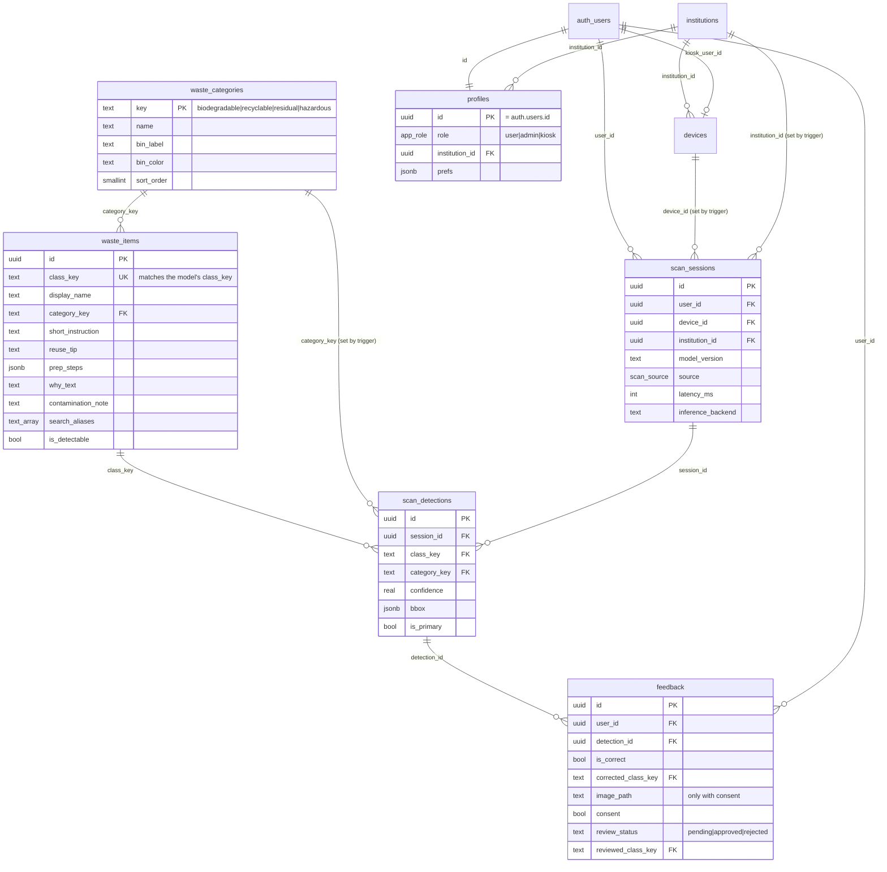

# iTapon Database (Supabase)

Roadmap Phase 10. Postgres 17 on Supabase, with **Row Level Security on every table**.

| Environment | Project | Ref | Region |
|---|---|---|---|
| dev | `itapon-dev` | `svvbvkdkgduyphkkaiio` | ap-northeast-1 (Tokyo) |
| prod | `itapon-prod` | not created yet (Phase 24; prefer Singapore) | |

## Entity-relationship diagram



**Differences from the roadmap sketch:** categories use their text `key` as the primary key (`category_key` instead of `category_id`). That's stable across environments and readable in queries. `scan_sessions.user_id` is **always set**, because every visitor is a signed-in user: anonymous guests (D3), registered users or kiosk accounts.

## Who can do what (RLS)

| Table | Not signed in | Signed-in user (incl. anonymous guest) | Admin (same institution) |
|---|---|---|---|
| `waste_categories`, `waste_items` | read | read | read + write |
| `profiles` | none | read own; update **only** `display_name`, `prefs` | read institution profiles |
| `institutions` | none | read own | read own |
| `devices` | none | kiosk reads own device | manage institution devices |
| `scan_sessions`, `scan_detections` | none | insert / read / delete **own**; no updates | read institution scans |
| `feedback` | none | insert (own detections, pending only) / read / delete own; no updates | read own institution's; review via `admin_review_feedback` |
| storage `training-images` | none | upload/read/delete under `<user_id>/…` | read photos of own institution's feedback |

Server-side rules that clients can't bypass:
- **Bins come from the database.** A trigger sets `scan_detections.category_key` from `waste_items`, whatever the client sends. An unknown `class_key` is rejected.
- **Kiosk context.** A trigger fills `device_id`, `institution_id` and `source = 'kiosk'` only for real kiosk accounts. Other users can't claim to be a kiosk.
- **No self-promotion.** Clients can't update `role` or `institution_id` (column privileges).
- **Profiles** are created automatically for every new auth user (trigger on `auth.users`).

RPCs (security invoker, so RLS applies): `daily_counts_by_category(p_from, p_to)`, `top_items(p_from, p_to, p_limit)`, `delete_my_data()`. Days are grouped in Asia/Manila time.

## Content (Bin Guide + bin mapping)

- **Edit** `supabase/content/waste_content.json`: 4 bins and 36 items (23 the model detects + 13 Bin-Guide-only), with Filipino names and aliases.
- **Regenerate** the seed: `pnpm db:seed:build` (runs `supabase/scripts/build_seed.py`; CI fails if `seed.sql` is stale).
- `services/ml-api/tests/test_content.py` checks that the 23 detectable items match the model's classes and bins exactly.

## Commands

```bash
pnpm exec supabase login                          # once per machine
pnpm exec supabase link --project-ref svvbvkdkgduyphkkaiio
pnpm db:push                                      # apply new migrations + seed (upserts)
pnpm --filter web db:types                        # regenerate apps/web/src/lib/database.types.ts
SUPABASE_URL=https://svvbvkdkgduyphkkaiio.supabase.co SUPABASE_ANON_KEY=<anon key> pnpm db:rls-check
```

New schema changes always go in a **new** migration file (`supabase migration new <name>`). Never edit an applied one.

## Verification (2026-10-17, itapon-dev)

- `supabase db push`: 4 migrations + seed applied with no errors.
- `supabase db lint`: no schema errors.
- `supabase/tests/rls-check.mjs`: **32/32 checks passed** (2026-10-17). Public read-only content; two anonymous users can't see, add to or delete each other's scans; server-side bin; no self-promotion to admin; prefs editable; RPCs scoped by RLS; `delete_my_data` works; feedback only on your own detections, never pre-approved, photo needs consent, no review by non-admins, no uploads into another user's folder (Phase 20).
