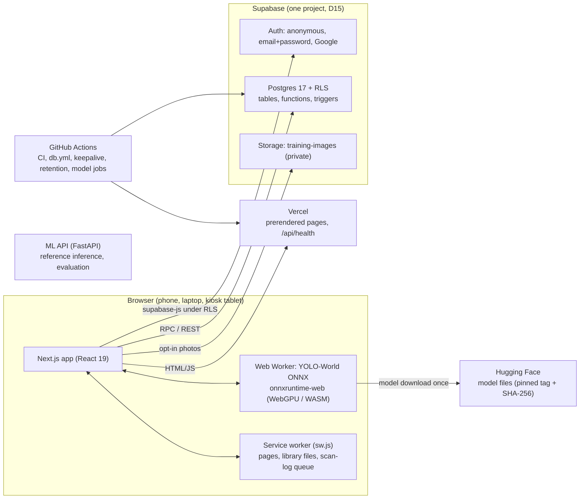

# iTapon: system documentation

**Status as of 22 October 2026 · app version 2.0.0 (tag pending the production smoke test)**

iTapon is a mobile-first web app that recognises waste items through the camera and tells
people which bin they go in under RA 9003: **Biodegradable** (green), **Recyclable** (blue),
**Residual** (black) or **Hazardous** (red). It adds a disposal library for specific items,
accounts, missions and points, a hands-free kiosk mode for bin stations, and a dashboard for
schools and offices.

CS 406 Machine Learning project, Technological Institute of the Philippines, Quezon City
(S.Y. 2026–2027). Source: <https://github.com/alchemistUser/itapon> (AGPL-3.0-or-later).
Live app: <https://itapon.vercel.app>.

For end users, see the [user manual](user-manual.md). For what's left to do, see
[ROADMAP-remaining.md](../ROADMAP-remaining.md).

---

## Contents

1. [Current state at a glance](#1-current-state-at-a-glance)
2. [Features](#2-features)
3. [Architecture](#3-architecture)
4. [Components](#4-components)
5. [Data model](#5-data-model)
6. [Security and privacy](#6-security-and-privacy)
7. [Offline and performance](#7-offline-and-performance)
8. [Points engine](#8-points-engine)
9. [Testing and quality](#9-testing-and-quality)
10. [Environments, CI/CD and operations](#10-environments-cicd-and-operations)
11. [Configuration reference](#11-configuration-reference)
12. [Common operations (runbook)](#12-common-operations-runbook)
13. [Decisions index](#13-decisions-index)
14. [Known limitations and open items](#14-known-limitations-and-open-items)
15. [Repository map and document index](#15-repository-map-and-document-index)

---

## 1. Current state at a glance

| Area | State | Notes |
|---|---|---|
| v1 core (scanner, Bin Guide, history, kiosk, admin, PWA) | **Live** | Roadmap Phases 1–24 |
| Pilot kit (consent, protocol, questionnaires, audit, report script) | **Ready**; pilot not run | Phase 25; needs people, place and dates |
| Disposal library (175 entries, 16 material groups, EN + FIL) | **Live**, labelled "Not reviewed yet" | Phases 27–30; AI-drafted, team review pending (D19, D25) |
| Accounts v2 (email + password, profile, age gate, join codes, export, delete) | **Live in code** | Phase 31; needs Supabase "Confirm email" **off** (D24) |
| Missions and points | **Live** | Phase 32 (D26) |
| Levels, streaks, badges, leaderboards | **Live** | Phase 33 |
| Admin analytics, campus content editor, evaluation tools | **Live** | Phase 34 |
| Feature flags, v2 release docs, staff guide | **Done** | Phase 35; v2.0.0 tag waits for the smoke test |
| Trained model (custom YOLO) | **Not done** | v1 runs zero-shot YOLO-World (D11) |
| Manuscript and defense | **Not started** | Phase 26 |
| Thesis scope | Library in; accounts and points are **future work** in the manuscript | D16, D20 |

Quality gates on `main` (all green on 22 October 2026): web lint, typecheck, 133 unit tests,
production build, 58 E2E tests (phone + desktop, with axe accessibility checks), ML API
(ruff + 52 pytest tests), content checks, the database role matrix (218 checks), secret scan
and dependency audit.

---

## 2. Features

### For everyone (no account needed)
- **Scanner** (`/scan`): live camera or photo upload; detects up to several items, locks on a
  stable result, shows the bin, a short instruction and confidence, reads it aloud (English or
  Filipino), and asks "Was this right?". Multi-item scans get a **"What to do next" plan**
  (`/scan/plan`).
- **Post-scan library card**: "Which one is yours?" chooser (for example PET water bottle vs
  HDPE shampoo bottle, with a resin-code tip), where else it can go, a reuse or reduce idea, the
  Quezon City rule and a link to the full entry.
- **Bin Guide** (`/guide`): the four bins, 36 common items, and fuzzy search in English,
  Filipino and Taglish. It is the entry point to the library.
- **Disposal library** (`/library`): 175 entries in 16 material groups and 71 subgroups. Each
  entry covers preparation steps, don'ts, hazards, where else it can go, reuse and reduce ideas,
  facts, local rules, sources, related and "commonly confused" items, an EN/FIL switch and read
  aloud. Search covers names, Filipino, aliases, materials and resin codes ("#5", "PP"), with
  typo tolerance and "did you mean".
- **Drop-off finder** (`/library/dropoff`): by type (e-waste, hazardous, junk shop, health
  centre, take-back, city programmes). It lists only verified places; otherwise it says what to
  do.
- **History** (`/history`): your own scans.
- **Missions** (`/missions`): daily and weekly missions, today's question and material quizzes.
  Guests can make progress; claiming points needs an account.
- **Offline**: the guide, scanner (after the first visit), result pages and the whole library
  work without a connection.
- **Accessibility**: WCAG 2.1 AA (axe-checked), read aloud, large text, Filipino.

### With an account
- Email + password sign-up that keeps your guest scans (same user); optional Google sign-in.
- Profile: handle, preset avatar, public toggle (adults only), birth year (private), consent
  record.
- Join a school or office with its **join code**; leave any time.
- Points, levels, streaks, 11 badges, the institution leaderboard (if public).
- Export your data (JSON, or scans as CSV), delete your data, delete your account, sign out
  everywhere, change password.

### Kiosk (`/kiosk`)
A tablet or laptop next to real bins: hands-free scanning, big bin colours in the order of the
physical bins, read aloud, a "where else / idea" line with a QR code to the library entry,
an idle screen with "Top recyclers this week", motion wake, wake lock, offline fallback, and
pairing to an institution with a 6-digit code.

### For institution admins (`/admin`)
- **Dashboard**: KPIs, items per day by bin, share by bin, top items, heatmap, per device,
  model health (confidence, wrong-rate from feedback, model versions, real-device speed), CSV
  export.
- **Kiosks**: registration and pairing, bin order, online hours.
- **Feedback review queue** for "Was this right?" answers and shared photos (own institution).
- **Disposal library usage**: views, chooser use, ideas planned and done.
- **Missions and search insights**: active and returning players, points per mission,
  players per day, **searches with no result** (content backlog, CSV).
- **Members**: join code (copy, rotate), member list, remove, hide from the leaderboard,
  **points on/off** for the institution.
- **Points**: scan-burst flags, top members, reversals with a reason.
- **Campus notes and drop-off points** editor (draft/publish).
- **Knowledge test** results (pre/post) and `knowledge.csv`.

### For researchers and facilitators
- **`/evaluate`**: pre/post knowledge test (12 "which bin?" items, participant codes only).
- **Pilot kit** in `docs/pilot/` and **`pilot_report.py`**, which produces Chapter 4 tables
  (SUS, tasks, ISO/IEC 25010, bin contamination, knowledge gain with Wilcoxon).
- **`/print/poster`**: a printable QR poster.

---

## 3. Architecture



**Key principles**

- **Inference runs in the browser** (D12). Camera images never leave the device unless someone
  ticks "share this photo". The model is downloaded once from a pinned Hugging Face tag,
  verified by SHA-256 and cached.
- **The browser talks to Supabase directly**, under Row Level Security. There is no custom
  backend for app data. Anything that needs rules (claims, joins, quizzes, deletion) is a
  `SECURITY DEFINER` Postgres function with its own checks.
- **Pages are prerendered**, including every library item page. Personal data loads in the
  browser after the page arrives, so the app works offline and is fast on slow networks.
- **Content is versioned in Git** (CSV and JSON under `supabase/content/`), validated by
  scripts, seeded into the database and bundled into the app.

### Main flows

**Scan.** The camera frame goes to the Web Worker's YOLO-World model. The stability gate locks a
result once the same class wins for several frames. The item maps to its bin (from the content
store, refreshed from `waste_items`), and the result shows with read aloud. The scan is logged
to `scan_sessions` / `scan_detections`; a trigger sets the bin and kiosk/institution context.
Offline, the log is queued in IndexedDB and sent later. Afterwards the library card loads
lazily and "Was this right?" can write `feedback`.

**Library.** Pages are prerendered from `src/content/library.json`. In the browser,
`public/library/index.json` (search, scan card) and `groups/<G>.json` (full entries) load on
demand and are cached by the service worker. Use is counted in `library_events` (no ids);
signed-in activity that missions count goes to `mission_activity`.

**Missions.** `mission_status()` returns today's and this week's missions with progress computed
on the server from scans, activity and quiz answers. "Claim" calls `claim_mission()`, which
checks everything and appends to `point_events`. Levels, streaks, badges and leaderboards are
derived from that ledger.

---

## 4. Components

### 4.1 Web app (`apps/web`)

Next.js 16.4 (App Router, Turbopack, Cache Components) · React 19 · Tailwind CSS v4 ·
TypeScript · Vitest 3 · Playwright 1.56 · lucide-react · fuse.js · recharts · qrcode ·
supabase-js (loaded on first use).

| Route | What | Rendering |
|---|---|---|
| `/` | Home (how it works, start scanning) | static |
| `/scan` | Live scanner (camera, photo upload, result sheet/panel) | static shell, client |
| `/scan/result/[item]` | Result for one of the 23 detectable items | prerendered |
| `/scan/plan`, `/scan/plan/[item]` | "What to do next" for multi-item scans | prerendered + client |
| `/guide`, `/guide/[category]` | Bin Guide | prerendered |
| `/library`, `/library/[group]`, `/library/[group]/[subgroup]` | Library home, groups, subgroups | prerendered |
| `/library/item/[slug]` | 175 library entries | prerendered |
| `/library/dropoff` | Drop-off finder | partial prerender |
| `/library/offline-item` | Offline fallback for uncached item pages | static, client |
| `/missions` | Missions, quizzes, level, badges, leaderboard, points history | client |
| `/history` | Your scans | client |
| `/account` | Sign-up/in, profile, institution, preferences, your data | client |
| `/admin` | Institution dashboard and panels | client (admins only) |
| `/kiosk` | Hands-free kiosk | client |
| `/evaluate` | Knowledge test (pre/post) | client |
| `/privacy` | Privacy notice (RA 10173) | static |
| `/offline` | Offline page | static |
| `/print/poster` | Printable QR poster | static |
| `/api/health` | `{status, version, build}` for monitoring | route handler |
| `/dev/*` | Developer pages (components, detector lab, soak test) | not linked |

**Key modules (`src/lib`)**

| Module | Purpose |
|---|---|
| `detector/` | Worker, model pins and hashes, pre/post-processing, store |
| `scan/` | Camera hook, scan loop, stability gate, multi-item plan, scan logging + offline queue |
| `content.ts`, `content-store.ts` | v1 item → bin content (bundled, refreshed from Supabase) |
| `library/` | Library types, pure helpers (`core.ts`), server copy (`server.ts`), browser loader and events (`client.ts`), search (`search.ts`) |
| `supabase/` | Client (lazy), auth (anonymous, email + password, Google) |
| `accounts.ts`, `accounts-client.ts` | Accounts v2 rules and data access |
| `points.ts`, `progress.ts` | Missions, quizzes, claims; levels, badges, leaderboards |
| `admin.ts`, `admin-v2.ts`, `analytics.ts` | Admin data and the pure analytics behind the charts |
| `prefs.ts`, `speech.ts` | Preferences; read aloud (EN/FIL voices) |
| `monitoring.ts` | First-party error reporting (`client_errors`) |

### 4.2 On-device detector

- **Model:** zero-shot **YOLO-World** with the 23 spec classes baked in as text prompts (D11),
  exported to ONNX, int8, 480 px input. Files are hosted on Hugging Face
  (`alchemistUserhf/itapon-yolo`, tag `v0.1`), pinned in `src/lib/detector/models.ts` with
  SHA-256 hashes checked by the worker and by `verify-model-pins.mjs` (model-regression workflow).
- **Runtime:** `onnxruntime-web` in a Web Worker, WebGPU when available, otherwise WASM
  (multi-threaded with cross-origin isolation). Measured on a desktop: about 280–300 ms per
  inference, 3.3–3.6 fps, stable over 10 minutes (`docs/qa/performance.md`).
- **Thresholds:** confident ≥ 0.35, possible ≥ 0.15. Below the confident threshold the result
  says "We think this is…" with alternatives. A stability gate prevents flicker, and the kiosk
  waits for the item to leave the frame before scanning again.
- **Classes (23):** plastic bottle, plastic cup, aluminum can, glass bottle, paper bag,
  cardboard, paper sheet, banana peel, food scraps, leaves, used tissue, snack wrapper,
  styrofoam, plastic utensil, straw, tetra pack, soiled food container, sanitary napkin, face
  mask, battery, light bulb, expired medicine, spray can (`docs/spec.md`).

### 4.3 ML API (`services/ml-api`)

FastAPI + Ultralytics (Python 3.12, uv). Endpoints: `GET /health`, `GET /v1/model`,
`POST /v1/detect`. Since D12 it is **not** on the user path. It is the reference
implementation for exporting and evaluating models, and the home of the Python scripts:

| Script | Purpose |
|---|---|
| `export_onnx.py`, `shrink_onnx.py`, `build_world_model.py` | Build and export the in-browser model |
| `model_regression.py`, `evaluate_field.py` | Regression set and field evaluation with a promotion rule (D13) |
| `export_feedback.py`, `purge_feedback_photos.py` | Feedback export; 12-month photo retention |
| `pilot_report.py` | Pilot/UAT report (SUS, tasks, ISO 25010, contamination, knowledge test) |
| `dump_openapi.py` | API contract |

### 4.4 Supabase

- **Auth:** anonymous users on first need (scan, missions, join); upgrade to email + password
  keeps the same user id (`updateUser`); Google sign-in behind `NEXT_PUBLIC_AUTH_GOOGLE=1`.
  **No emails are sent** (D24): confirmation must be off in the dashboard; passwords are reset
  by the team.
- **Database:** Postgres 17 with RLS on every table (section 5). Migrations live in
  `supabase/migrations/` (roll forward only).
- **Storage:** private bucket `training-images` for opt-in shared photos, `<user id>/…` paths,
  readable only by reviewers.

### 4.5 Content pipelines

| Pipeline | Source | Script | Outputs |
|---|---|---|---|
| v1 items (36, 23 detectable) | `supabase/content/waste_content.json` | `build_seed.py` | `supabase/seed.sql`, `apps/web/src/content/waste_content.json` |
| Disposal library (175) | `supabase/content/library/*.csv` (sources, materials, destinations, `items/<GROUP>.csv`, local rules, drop-off points) | `build_library.py` | `supabase/seed_library.sql`, `apps/web/src/content/library.json`, `apps/web/public/library/index.json` + `groups/*.json`, `docs/library/coverage.md` |

`build_library.py` validates structure, lengths, sources, Filipino and **safety rules** (no
burning or draining advice, no reuse ideas for hazardous items, hazard text required, two
reviewers and a primary source to publish hazardous items). CI runs both scripts with
`--check`. By default the app copies include unreviewed drafts flagged `draft: true` (D25);
`--published-only` drops them.

---

## 5. Data model

Full ERD for the v1 tables: [database.md](database.md). Every table has RLS. "Owner" means the
signed-in user the row belongs to.

| Domain | Table | Purpose | Who can read | Who can write |
|---|---|---|---|---|
| Content | `waste_categories`, `waste_items` | 4 bins; 36 v1 items and instructions | everyone | team |
| Org | `institutions` | schools/offices; `join_code`, `points_enabled` | members, admins | admins (own, via functions) |
| Org | `profiles` | role, institution, display name, prefs, handle, avatar, public toggle, `leaderboard_hidden` | owner; own institution's admins | owner (limited columns) |
| Org | `profile_private` | birth year (age gate) | **owner only** | owner (one correction) |
| Org | `consents` | privacy notice / guardian notice with version and date | owner | owner (insert only) |
| Kiosk | `devices`, `kiosk_pairings`, `kiosk_heartbeats` | kiosks, 6-digit pairing, uptime | admins (own) | functions |
| Scans | `scan_sessions`, `scan_detections` | scan logs (no images) | owner; own institution's admins | owner (insert, delete) |
| Scans | `feedback` | "Was this right?", optional photo path | owner; reviewers | owner |
| Ops | `client_errors` | browser error log | team | anyone (insert only) |
| Library | `library_sources`, `library_materials`, `library_destinations`, `library_items`, `library_item_destinations` | the library | everyone (published items only) | team |
| Library | `library_local_rules`, `library_dropoff_points` | city (QC) and campus notes and places | published: everyone (city) / members (campus) | admins (own campus) |
| Library | `library_events` | view, chooser, idea counts (no ids) | admins via `library_event_counts()` | anyone (insert only) |
| Library | `library_search_misses` | searches with no result (no ids) | admins via `admin_search_misses()` | via `log_search_miss()` |
| Points | `missions` | 10 mission definitions | everyone | team |
| Points | `point_events` | append-only ledger (awards, reversals) | owner; own institution's admins | functions only |
| Points | `mission_activity`, `quiz_answers` | what missions count | owner | functions only |
| Points | `point_flags` | scan-burst flags | own institution's admins | functions only |
| Points | `badges`, `user_badges` | badge catalogue; earned badges | everyone; owner | functions only |
| Evaluation | `knowledge_tests` | pre/post scores under participant codes | own institution's admins | `submit_knowledge_test()` |
| Release | `feature_flags` | project-wide switches (`points`) | everyone | team |

**Important functions** (all check the caller): `delete_my_data`, `delete_my_account`,
`export_my_data`, `handle_available`, `join_institution`, `leave_institution`,
`admin_rotate_join_code`, `admin_remove_member`, `mission_status`, `claim_mission`,
`my_points`, `my_progress`, `record_activity`, `daily_quiz`, `group_quiz`, `answer_quiz`,
`refresh_badges`, `institution_leaderboard`, `admin_set_leaderboard_hidden`,
`admin_reverse_points`, `admin_points_stats`, `admin_search_misses`, `log_search_miss`,
`knowledge_test_items`, `submit_knowledge_test`, `points_status`, `admin_set_points_enabled`,
`kiosk_request_pairing`, `admin_register_kiosk_code`, `kiosk_heartbeat`, `kiosk_uptime`,
`daily_counts_by_category`, `top_items`, `library_event_counts`, `admin_review_feedback`,
`purge_client_errors`.

---

## 6. Security and privacy

- **RLS everywhere**, tested by the **role matrix** (`supabase/tests/rls-roles.sql`, 218
  checks across anon, users, a kiosk and two admins of different institutions; run in a
  rolled-back transaction by CI on every push and by `db.yml` on production).
- **No client writes to points, badges, flags, global content or other people's rows.** Rules
  live in definer functions with rate limits (`private.rate_guard`) where guessing or spamming
  matters (join codes, handle checks, claims, activity, tests).
- **Web hardening:** CSP and security headers, COOP/COEP for the threaded WASM runtime, model
  hash pinning, secret scan (gitleaks) and dependency audit in CI. Checklist:
  [security.md](security.md).
- **Privacy (RA 10173):** the notice at `/privacy` lists every data item, purpose, who sees it
  and retention. Highlights:
  - camera images stay on the device; scan logs have no images; photos are shared only per photo
    with consent and deleted after 12 months;
  - library counts and "not found" searches carry no ids;
  - the birth year is owner-only; under-18s (conservative rule: adult from 1 January of birth
    year + 19) can't go public or appear on leaderboards (D22);
  - admins never see emails, birth years or consents;
  - export and delete are self-service.
  The accounts privacy review ([accounts/privacy-review.md](accounts/privacy-review.md)) is
  **awaiting adviser approval**.
- **Secrets** live only in the Vercel, Supabase and GitHub settings. The service-role key is
  used only by GitHub Actions secrets.

---

## 7. Offline and performance

- **Service worker** (`public/sw.js`, hand-written, D14):
  - pages are network-first with a cached fallback, `/offline`, and `/library/offline-item` for
    uncached library entries;
  - `_next/static` is network-first;
  - other same-origin files are stale-while-revalidate;
  - once per deploy it pre-caches the key pages, the library index, all 16 group files and
    group pages.
- **Model cache:** the detector worker caches model files (`itapon-models-v1`).
- **Budgets:** `/scan` loads the library card and feedback prompt lazily, so its first-load
  scripts contain no library code. The whole library is about 60 KB gzipped. Lighthouse on
  regular 4G: LCP 1.1 s, TBT 130–160 ms.
- **Database load check** (`supabase/tests/points-perf.sql`, 300 players): 0.4–39 ms per call;
  the leaderboard is the heaviest.

---

## 8. Points engine

Full rules: [points.md](points.md). In short:
- the same 3 daily and 3 weekly missions for everyone, picked from the date;
- each pays once per period, with caps of 30 per day and 150 per week;
- only signed-in accounts can claim, and only distinct items, groups and bins count;
- scans must be 5 s apart (30 per hour), and bursts are flagged;
- quizzes are checked on the server with one try per question;
- admins can reverse awards, and the ledger keeps everything traceable.

Levels 1–10 (Seedling → Earth Keeper), a streak with one grace day, 11 badges and
institution leaderboards (public adults with a handle, accounts 3+ days old, not hidden). The
`points` feature flag (team) and each institution's switch (admins) can pause claims and
leaderboards.

**Honest limit:** scan results come from the device, so a determined cheater could fake scans.
The caps bound what that can earn. Points reward learning and correct use, not proven
disposal (D26).

---

## 9. Testing and quality

| Layer | Tool | Count | Where |
|---|---|---|---|
| Web unit and component | Vitest + Testing Library | 133 | `apps/web/src/**/*.test.ts(x)` |
| End-to-end + accessibility | Playwright + axe (phone and desktop) | 58 | `apps/web/e2e/` |
| Real offline test | Playwright with its own server, stopped mid-test | 1 (×2) | `e2e/offline.spec.ts` |
| Fake-camera scan and soak | Playwright `scan` project (local, needs a sample photo) | 2 | `e2e/scan.spec.ts`, `soak.spec.ts` |
| ML API and scripts | pytest + ruff | 52 | `services/ml-api/tests/` |
| Content | `build_seed.py --check`, `build_library.py --check` | 175 items, 0 errors | CI |
| Database permissions | Role matrix | 218 | `supabase/tests/rls-roles.sql` |
| Database load | Timing script | 6 calls | `supabase/tests/points-perf.sql` |
| Model | Regression set, field evaluation | — | `ml/regression-set`, scripts |
| Manual | Device matrix, field test, performance sheets | — | `docs/qa/` |

Signed-in flows (claims, quizzes, export, admin panels) are covered by the role matrix
rather than by E2E, because CI has no Supabase backend.

---

## 10. Environments, CI/CD and operations

| Environment | Web | Database |
|---|---|---|
| Production | Vercel, `main` → <https://itapon.vercel.app> | Supabase `itapon-dev` (ref `svvbvkdkgduyphkkaiio`, Tokyo), shared with dev (D15) |
| Preview | Vercel preview per branch/PR | same project: test with throwaway accounts |
| Local | `pnpm dev` (port 3000), `pnpm build && pnpm start` | same project, or a local Supabase |

| Workflow | Trigger | What it does |
|---|---|---|
| `ci.yml` | every push / PR | web lint, typecheck, unit, build; E2E + axe; ML API ruff + pytest; content checks; role matrix (dev); gitleaks; dependency audit |
| `db.yml` | push to `main` touching migrations, seeds or itself | dry run, `db push --include-seed`, **re-applies the library seed**, role matrix on production |
| `keepalive.yml` | daily 11:17 PH time | keeps the free-tier project from pausing |
| `retention.yml` | monthly | deletes shared photos older than 12 months, purges old client errors |
| `model-export.yml` | manual | export the in-browser model |
| `model-regression.yml` | changes to the model pin or regression set (PR and `main`), manual | verify model pins and hashes, run the regression set |

Release and rollback: [release.md](release.md) (v2 checklist; rollback turns the `points` flag
off first, then Vercel Instant Rollback; database roll-forward only). Monitoring: first-party
`client_errors`, real-device speed on `/admin`, `/api/health`.

---

## 11. Configuration reference

**Vercel / `.env.local` (all public, `NEXT_PUBLIC_*`)**

| Variable | Purpose |
|---|---|
| `NEXT_PUBLIC_SUPABASE_URL`, `NEXT_PUBLIC_SUPABASE_ANON_KEY` | Supabase project (the anon key is public by design; RLS protects data) |
| `NEXT_PUBLIC_SOURCE_URL` | AGPL source link in the footer |
| `NEXT_PUBLIC_MODEL_BASE_URL` | optional model host override (dev/preview) |
| `NEXT_PUBLIC_AUTH_GOOGLE` | `1` shows "Continue with Google" (needs the Google provider in Supabase) |
| `NEXT_PUBLIC_BUILD_ID`, `NEXT_PUBLIC_APP_VERSION` | set by `next.config.ts` (commit SHA, `package.json` version) |

**GitHub secrets:** `SUPABASE_ACCESS_TOKEN`, `SUPABASE_PROD_DB_PASSWORD`, the retention job's
`SUPABASE_URL` / `SUPABASE_SERVICE_ROLE_KEY`; variable `SUPABASE_PROD_PROJECT_REF`.

**Supabase dashboard (not in code):**
- Authentication → Email: **Confirm email off**, minimum password length **8** (D24). These
  are mirrored in `supabase/config.toml` for local use.
- Rate limits and the URL configuration (site URL `https://itapon.vercel.app`).

**Runtime switches:** `feature_flags.points` (team, SQL) and `institutions.points_enabled`
(admins, Members panel).

---

## 12. Common operations (runbook)

| Task | How |
|---|---|
| Make someone an institution admin | They sign up once; then in the SQL editor: create the institution if needed and `update public.profiles set role = 'admin', institution_id = '<id>' where id = (select id from auth.users where email = '<email>');` ([kiosk-setup.md](kiosk-setup.md)) |
| Reset a forgotten password | Supabase → Authentication → Users → the user → set a new password, after checking it's really them (no reset emails, D24) |
| Publish a reviewed library entry | Edit its CSV row (`status = published`, `reviewed_by`, `reviewed_at`), run `python supabase/scripts/build_library.py`, commit; `db.yml` applies the seed |
| Add a new library entry | Add a row to `items/<GROUP>.csv` per [library/entry-template.md](library/entry-template.md), build, commit |
| Pause points everywhere | `update public.feature_flags set enabled = false where key = 'points';` |
| Pause points for one institution | That admin: Members panel → points switch off |
| Register a kiosk | `/kiosk` shows a 6-digit code → `/admin` → Kiosks → enter the code ([kiosk-setup.md](kiosk-setup.md)) |
| Roll back a bad deploy | Vercel → Deployments → previous → Instant Rollback |
| Undo a database change | New migration, merged to `main` (never edit production by hand) |
| Check permissions after a schema change | `node supabase/tests/run-rls-roles.mjs` |
| Pilot report | `uv run python -m scripts.pilot_report --data ../../pilot/data --out ../../pilot/data/report.md` |
| Retrain / swap the model | [retraining.md](retraining.md) |

---

## 13. Decisions index

Full text in [ROADMAP.md](../ROADMAP.md) §1.

| # | Decision |
|---|---|
| D1 | Product name iTapon |
| D2 | Open source, AGPL-3.0 |
| D3 | Warming-up screen while the model loads |
| D4 | Next.js + Tailwind on Vercel |
| D5 | Python/FastAPI/Ultralytics for model work |
| D6 | Supabase (Auth, Postgres + RLS, Storage) |
| D7 | Object detection; item → bin mapping in the database |
| D8 | 23 v1 classes |
| D9 | Dirty vs clean shown as a caveat, not classes |
| D10 | Tool versions (Node 20, pnpm 9, Next 16.4, Tailwind 4, Python 3.12, uv) |
| D11 | Zero-shot YOLO-World for v0 |
| D12 | Inference in the browser (ONNX, Web Worker) |
| D13 | Feedback review and model promotion rule |
| D14 | Hand-written service worker |
| D15 | One Supabase project for dev and production |
| D16 | Library in the thesis; accounts and points are future work |
| D17 | National rules + Quezon City/TIP overrides |
| D18 | Team review against sources; two reviewers for hazardous |
| D19 | Claude drafts library entries; the team publishes |
| D20 | Accounts v2 built now, future work in the manuscript |
| D21 | Brevo SMTP (superseded for the demo by D24) |
| D22 | Age gate: birth year only, minors private |
| D23 | One rotatable join code per institution |
| D24 | Email + password with no emails sent |
| D25 | All 175 library entries shown, labelled "Not reviewed yet" |
| D26 | Points from daily and weekly missions, not kiosk claims |
| D27 | Points on by default; flags to pause |

---

## 14. Known limitations and open items

**Product and technical**
- Zero-shot model: accuracy on real Philippine waste isn't measured yet; a trained model is
  deferred. Low-light and cluttered scenes reduce confidence.
- Library entries are AI-drafted and not yet reviewed (D25). The drop-off finder has no
  verified places until admins add them.
- No emails: no account confirmation, magic links or password reset (D24). Extra accounts are
  easy to create; points have no cash value and caps bound abuse.
- Scan results come from the device and could be faked (bounded by the caps).
- One shared Supabase project for dev and production (D15).
- Institution-run prizes aren't built (D26).
- Signed-in screens are verified by database tests, not by browser E2E against a backend.

**Waiting on the team** (details in [ROADMAP-remaining.md](../ROADMAP-remaining.md))
1. Turn off "Confirm email" in Supabase; production smoke test; tag v2.0.0.
2. Review and publish library entries; verify 3 sources; add campus notes and drop-off points.
3. Adviser approval of the privacy review and the minors rule; a profanity/reserved-word list.
4. Run the pilot (with knowledge pre/post tests); the device matrix on real phones.
5. Phase 26: manuscript, model card, user and admin guides (see the [user manual](user-manual.md)),
   defense demo.

---

## 15. Repository map and document index

```
apps/web/              Next.js app (src/app routes, src/components, src/lib, e2e, public/sw.js)
services/ml-api/       FastAPI reference API + Python scripts (export, evaluation, pilot report)
ml/                    configs, notebooks, data notes, regression set
supabase/
  migrations/          schema, RLS, functions (roll forward only)
  content/             v1 items JSON + library CSVs
  scripts/             build_seed.py, build_library.py
  tests/               rls-roles.sql (+ runner), points-perf.sql
  templates/           bilingual email templates (unused while D24 holds)
docs/                  documentation (below)
pilot/                 pilot data folder (templates, report output)
.github/workflows/     ci, db, keepalive, retention, model jobs
```

| Document | For |
|---|---|
| [user-manual.md](user-manual.md) | Everyone who uses iTapon |
| [staff-guide.md](staff-guide.md) | Institution admins (short version) |
| [spec.md](spec.md) | Classes, bin mapping, metrics, user stories |
| [database.md](database.md) | Database, ERD, RLS |
| [security.md](security.md) | Security and privacy checklist |
| [release.md](release.md) | Environments, release, rollback, monitoring |
| [kiosk-setup.md](kiosk-setup.md) | Setting up a kiosk |
| [retraining.md](retraining.md) | Feedback → retraining → promotion |
| [setup-accounts.md](setup-accounts.md) | One-time service setup |
| [points.md](points.md) | Missions, points, levels, badges, leaderboards |
| [library/](library/README.md) | Library taxonomy, template, style guide, sources, coverage |
| [accounts/](accounts/privacy-review.md) | Privacy review, readiness, email setup |
| [pilot/](pilot/README.md) | Pilot protocol, consent, questionnaires, audit |
| [qa/](qa/README.md) | Device matrix, field test, performance |
| [ROADMAP.md](../ROADMAP.md), [ROADMAP-v2.md](../ROADMAP-v2.md), [ROADMAP-remaining.md](../ROADMAP-remaining.md) | Plans, decisions, status |
| [CHANGELOG.md](../CHANGELOG.md) | Release notes |
